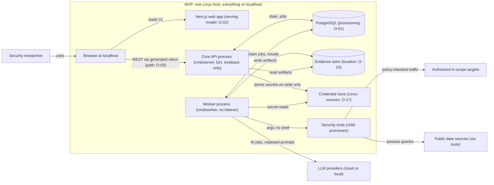
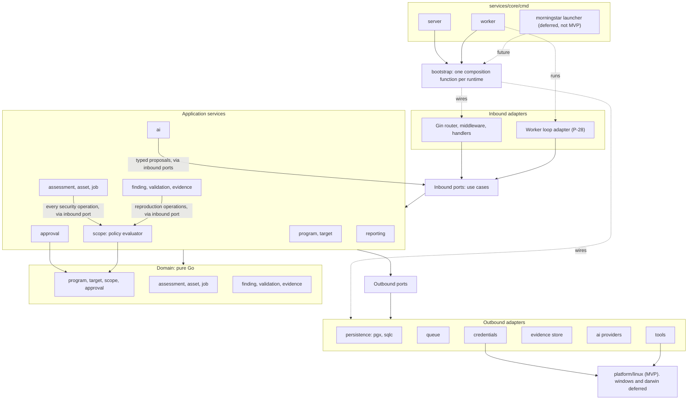
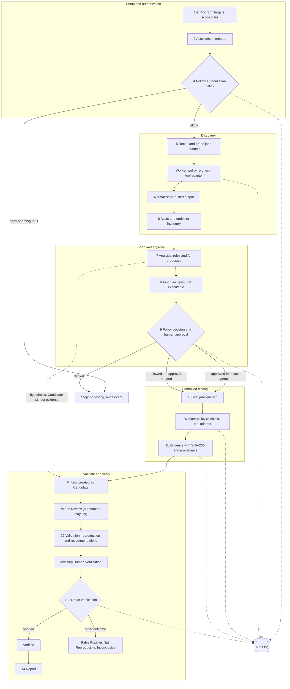

# MORN1NGST4R architecture

Status: draft for review, revision 8 (Round 6 foundation closure applied as D-63 to D-85, `LICENSE` and repository hygiene added; revision 7 contents: MVP platform decision applied, foundation audit corrections applied, owner approvals A1 to A4 of audit Round 1 adopted, owner security decisions of Round 2 adopted as D-30 to D-46, Round 3 amendments to D-30, D-32, D-33, D-35, D-38 and D-45 recorded, B1 security requirements applied to `security.md`, owner conservative decisions of Round 5 adopted as D-47 to D-62, technology baseline recorded in `tech.md`). No application code exists yet. This document refines `product.md`, `structure.md` and `security.md`. It does not replace them. Package boundaries, layering rules and security requirements come from them unchanged. The owner's confirmed MVP platform decision (D-16 to D-22) is narrower than their wording on desktop packaging, Windows, macOS and deployment modes. For the MVP that decision governs, and the passages it outdates are listed in section 19 under "Steering alignment" for the owner to approve. Those files are not edited here. The `MVP` citation refers to that decision as the owner gave it in the working session. It is not yet recorded in `product.md` or in an ADR, and section 19 lists that as an alignment item.

## How to read this document

| Tag | Meaning |
| --- | --- |
| **[Decided]** | Stated in `product.md`, `structure.md` or `security.md`, or confirmed by the project owner. The source is cited as `P`, `S` or `SEC` plus the section number. `MVP` plus a number cites the owner's MVP platform decision (`MVP 1` to `MVP 6` are its "Important Distinctions", `MVP-PG` is its PostgreSQL decision). `AUD` plus a code (`A1` to `A4`) cites the owner's approval of that item in the foundation audit, Round 1. `SDR` plus a code (`DR-01` to `DR-17`) cites the owner's security decision of Round 2, recorded in `docs/decisions/0001-owner-security-decisions-round-2.md`. `R6` cites the owner's Round 6 closure instruction, recorded in `docs/decisions/0003-foundation-closure-decisions.md`. `R5` plus a code cites the owner's Round 5 decision (the Round 4 finding or the C2 item), recorded in `docs/decisions/0002-foundation-completion-decisions.md`. |
| **[Proposed]** | A recommendation inside the decided constraints. It needs review, and an ADR in `docs/decisions/` before implementation. |
| **[Open]** | Not decided. No default is assumed. Section 19 lists every open item with its options. |

Identifiers: `D-` decided, `P-` proposed, `O-` open (section 19). IDs are never reused or renumbered. A changed or resolved item keeps its ID, and section 19 records what changed. A security-sensitive feature still needs the review required by `SEC` section 18 (threats, trust boundaries, permissions, abuse cases, failure modes, logging, tests) before it is built.

## 1. Architectural vision and principles

MORN1NGST4R helps an independent bug bounty hunter or security researcher run the full lifecycle of an authorized assessment: register a program, define scope, discover assets, plan and run controlled tests, preserve evidence, validate findings, verify them as a human, and report. It is local-first and open source (`P` 1, D-15). Its core philosophy is "Evidence-driven security assessment, with human-verified findings" (`P` 3).

**MVP delivery model (D-16, D-17).** The MVP is a local-first web application. The researcher opens a browser on localhost and uses a Next.js UI backed by a Go and Gin API, a Go background worker, PostgreSQL, local evidence storage and local security tool integrations. Initial development and the primary MVP environment is Linux localhost. Native desktop packaging, Windows and macOS support, and Linux headless server deployment are not MVP deliverables (D-18 to D-20). The architecture keeps them possible through clean boundaries (D-21), not through MVP work.

| Principle | Architectural consequence |
| --- | --- |
| Evidence over assumption | A scanner result or AI hypothesis is only a Candidate (D-09). The domain state machine, not caller discipline, refuses automated promotion to Verified (P-02, P-10). |
| Security by architecture | One policy evaluator is the mandatory gate for every security operation. It fails closed (D-05). UI checks and AI instructions are never enforcement. |
| External data is untrusted | Tool output, HTTP responses, AI output and file contents are validated and size-limited at the adapter boundary before they enter the application layer. |
| Separate responsibilities | AI proposes. Policy decides. A human approves. A worker executes. Evidence records. A human verifies. No component holds two of these roles (sections 8 to 12). |
| One core, any delivery mode | The MVP ships one mode (localhost web on Linux). Domain and application code stay free of OS, UI-hosting and deployment assumptions, so later modes differ only in composition roots, platform adapters and auth configuration (D-14, D-21). |
| Localhost is not trusted | A loopback listener is reachable by other local users and, through the browser, by any web page the user visits. The API authenticates and validates origin even on localhost (P-19, TB1). |
| Modular monolith | One Go module and PostgreSQL as the only database. Module boundaries are enforced by tests, not convention (D-01, D-04). |
| Replaceable edges | Tools, LLM providers, credential stores, queues and evidence storage sit behind small consumer-owned ports. |
| Everything is auditable | Authorization, approvals, jobs, tool runs, evidence access and finding changes produce structured audit events (D-12). |
| No speculative infrastructure | PostgreSQL is the only stateful service. Anything else needs a demonstrated requirement (section 19). |

Non-goals for the first vertical slice (`P` 9, D-13, D-18 to D-20): multi-tenant SaaS, distributed microservices, Kubernetes, autonomous exploitation, fully autonomous verification, an advanced business logic engine, large-scale graph infrastructure, every possible scanner, native desktop packaging, Windows and macOS delivery, Linux headless server deployment.

## 2. System context

In the MVP everything runs on one Linux host. The researcher uses a browser on that host, at a localhost address. The browser loads the Next.js UI and calls the Go API. The API, the worker and PostgreSQL run as local processes. Security tools run as child processes of the worker and send policy-checked traffic to authorized targets. A later headless deployment would put the browser on a different machine and is not an MVP requirement (D-20). See diagram D1 in section 20.

| Element | Role | Trust |
| --- | --- | --- |
| Researcher | Registers programs, defines scope, approves risky operations, verifies findings | Authenticated principal. The only role that can approve or verify. |
| Browser | Runs the UI on localhost | Untrusted client. Other tabs and pages in the same browser are also untrusted callers of the loopback API (TB1). |
| Web UI | Next.js client. How it is served is Open (O-02). | Untrusted. Not an authorization boundary (`S` 8). |
| Core API process | Gin HTTP API and use-case execution | Trusted code. Enforces auth, policy and audit. |
| Worker process | Executes jobs and invokes tools | Trusted code, least privilege. Re-validates policy before every execution. |
| PostgreSQL | System of record, including the persistent job queue (P-06). Provisioning strategy is Open (O-01). | Trusted store. Holds no secret values (D-08). |
| Evidence store | Write-once artifact files (P-08). Location is Open (O-23). | Sensitive. Access-controlled and audited. |
| Credential store | Linux Secret Service only, failing closed without it (D-52). | Trusted. Values never leave it except to the in-memory use site. |
| Security tools | subfinder, httpx, nuclei and similar, run as child processes | Untrusted output. Restricted execution. |
| LLM providers | Cloud or local models | Untrusted output. Selection never changes policy (D-07). |
| Authorized targets | The assets under test | Only in-scope targets receive test traffic from tools. Tools may contact other destinations too (passive data sources, update and template servers, callback services). Those are governed by the tool manifest and policy (P-26). |
| Public data sources | Reached by tools during passive recon | Untrusted content. |

Trust boundaries that need explicit controls:

| ID | Boundary | Main threat | Control (section) |
| --- | --- | --- | --- |
| TB1 | Browser and UI to API | Forged or replayed requests, privilege confusion. On localhost also: a malicious web page calling the loopback API (CSRF, DNS rebinding, permissive CORS) and other local users reaching the port. | Authentication even on loopback, origin and Host validation, restricted CORS, CSRF protection, authorization in use cases (5, P-19) |
| TB2 | API to worker through the queue | Tampered or stale job treated as authorization | Worker re-validates policy (8, 14) |
| TB3 | Worker to tool process | Command injection, option injection, runaway process, hostile output, secrets visible to other local users through the process list | Argv schema and option guard, secrets never in argv, limits, strict parsing (10, P-25) |
| TB4 | Core to targets | Out-of-scope traffic, redirect or DNS drift, in-scope names resolving to private or metadata addresses | Scope enforcement at execution time (8, P-24) |
| TB5 | Core to LLM provider | Prompt injection in, data egress out | Proposals only, redaction, egress default and audit (9, P-34) |
| TB6 | Core to credential store | Secret disclosure | No plaintext fallback, no logging (15) |
| TB7 | Core to evidence files | Tampering, traversal, unsafe rendering | Hash on write and read, IDs not paths (11) |
| TB8 | Core to PostgreSQL | Over-privileged access, secret exposure in connection settings | Separate roles, credential by reference (13, P-13, P-18) |

## 3. Modular monolith

**[Decided]** (`S` 1, 2): one monorepo, one Go module under `services/core`, executables `server` and `worker` plus an optional `morningstar` launcher, PostgreSQL as the database. The MVP builds `server` and `worker` only (D-03). The launcher is not an MVP deliverable (D-18) and its directory is not created until it is approved. Modules communicate through explicit interfaces. There are no circular dependencies and no cross-domain database access that bypasses the owning module's contract.

Allowed dependency directions and the domain dependency order are set in `structure.md` section 5.6. The owner approved them (`AUD` A2, D-23, D-24). They are not repeated here, so there is one source of truth. In summary: imports point toward the domain and the ports, `bootstrap` is the only package that composes everything, and `infrastructure` may be imported by adapters but imports none of `domain`, `application` or `adapters`.

P-01: domain packages may reference each other only through ID types owned by the referenced package, and only along the dependency order in `structure.md` section 5.6. A cycle is a build-time failure, and the fix is to change which side holds the reference, not to add a shared package. P-23 (the order itself and the leaf packages `operation` and `actor`) is adopted as D-23. The leaves are small, closed-membership packages named for the concept, so they are not the "generic shared package" `S` 2 warns against.

**Why not microservices:** the MVP serves one researcher on one machine (D-16), `P` 9 excludes distributed microservices, and one process boundary already exists where it matters: tool execution runs in the worker, not the API. **Revisit trigger:** a measured need for independent scaling or isolation that a second worker process on the same code cannot meet. None is demonstrated.

## 4. Component responsibilities and boundaries

Domain (`S` 5.1). Pure business rules, state transitions, invariants and domain errors.

| Domain | Owns | Notes |
| --- | --- | --- |
| `program` | Program identity and rules text | Every assessment belongs to a program (`SEC` 2) |
| `target` | Registered targets | Registration is explicit |
| `scope` | In-scope rules, out-of-scope rules, exclusions, target eligibility | Default deny |
| `assessment` | Assessment lifecycle and state | Create, start, pause, complete |
| `asset` | Domains, IPs, services, HTTP services, endpoints, parameters, relationships, observation history | Observed facts, not authorization |
| `job` | Job identity, state, limits | Persistent execution unit |
| `finding` | Finding identity and lifecycle | Candidate through Verified |
| `evidence` | Evidence metadata, provenance, integrity requirements | SHA-256 |
| `validation` | Validation attempts, results, recommendations | Separate from report status |
| `approval` | Approval state and its binding constraints | Human only |
| `operation` | Canonical operation value type and its hash (leaf package) | Imported by `approval`, `job`, `evidence` (D-23) |
| `actor` | Actor kind (human, system, ai) and identity reference (leaf package) | Imported by `approval`, `identity`, `audit`, `job` (D-23) |
| `identity` | User principal and session lifecycle rules | Follows the authentication decision (D-60) |
| `audit` | Audit event types and the append-only contract | Written through the `AuditSink` port (D-23) |

Application (`S` 5.2). One bounded use-case area each: `program`, `target`, `scope` (evaluates whether an action is allowed), `assessment`, `asset`, `job`, `finding`, `evidence`, `validation`, `approval`, `auth`, `ai`, `reporting`. There is no giant `AssessmentService` or `AIService`. Cross-domain workflows go through inbound ports, not through another module's internals.

Ports (`S` 5.3). Inbound ports expose use cases. Outbound ports are owned by their consumer and kept small. `S` 3 also plans one central `internal/ports/` directory, which pulls the other way (a central package is producer-owned). Proposed reading (P-29): keep `ports/outbound` split by consuming application area, one small file per consumer, and never one big shared interface file. Named in `structure.md`: `ProgramRepository`, `TargetRepository`, `AssessmentRepository`, `FindingRepository`, `EvidenceRepository`, `JobRepository`, `JobQueue`, `CredentialStore`, `LLMProvider`, `ToolExecutor`, `EvidenceStore`. That list is "examples". Likely additions (P-07, section 17): repositories for scope rules, approvals, assets and validations, a `Transactor`, and an `AuditSink`. Names are not final.

Adapters (`S` 5.4). Inbound: Gin router, middleware, request parsing, response serialization. Outbound: `persistence`, `queue`, `credentials`, `evidence`, `ai`, `tools`. Adapters translate. They never own a business workflow. The worker needs a loop that claims jobs and calls a use case. The owner approved a small inbound adapter for it (`adapters/inbound/worker`, D-25, `AUD` A2, P-28), because `cmd/worker` and `bootstrap` must hold no logic.

Cross-cutting concepts and their homes, approved in `structure.md` (D-23, D-24, `AUD` A2): audit events (`SEC` 13) are the `audit` domain package plus the `AuditSink` outbound port with a persistence adapter. User identity and sessions (`SEC` 8) are the `identity` domain package plus an `application/auth` use case behind the HTTP middleware. The `actor` leaf is what P-02 needs. Shared technical code is `internal/infrastructure`. Plan items and AI proposals belong to the `assessment` domain (P-38, still Proposed). Not yet defined: the contents of `identity` and `auth` (they follow the owner's MVP authentication decision, O-16 and C2 item 2), credential and settings configuration (`SEC` 13), and the report entity (O-27). Whether the MVP has exactly one local user is Open (O-25).

Platform (`S` 5.5, 10). `platform/<os>` packages hold OS-specific behavior behind shared interfaces, and Go build constraints select the implementation. A directory per OS is not selected by constraints alone (importing `platform/linux` on another OS fails to build), so `bootstrap` composes the right one through per-OS files such as `platform_linux.go` (P-21). The MVP implements `platform/linux` only (D-17). `platform/windows` and `platform/darwin` are not created until Windows or macOS work is approved (D-19), consistent with `S` 3 ("do not create all directories automatically"). The boundary is what keeps those platforms possible: OS-specific code appears only under `platform/` and those composition files (P-21). Proposed rule (P-21): platform packages never contain business rules. The `platform` row in `structure.md` section 5.6 says "standard library and OS APIs" and that cannot cover a D-Bus Secret Service client. Which third-party libraries `platform/linux` may use is decided with O-17.

Responsibility separation that must hold in code:

| Concern | Owner | Cannot do |
| --- | --- | --- |
| Propose analysis, plans, hypotheses | `application/ai` | Execute tools, approve, change scope, set Verified, read secrets |
| Decide whether an operation is allowed | The pure decision function in `domain/scope` (using `domain/approval`) called only by the `application/scope` evaluator use case (P-03) | Run tools, call an LLM |
| Grant approval | `application/approval`, human principal only | Be invoked by AI or worker |
| Execute an operation | Worker through `ToolExecutor` | Decide its own authorization |
| Record evidence | `application/evidence` | Judge findings |
| Verify a finding | Human through `application/finding` | Be done by automation |

Diagram D2 in section 20 shows the component structure.

## 5. Backend architecture and request flow

**[Decided]** (`S` 7): Gin is isolated in the inbound HTTP adapter. Handlers are thin: parse and validate transport input, call a use case, map the result. Handlers contain no domain rules, never touch repositories and never invoke tools.

Request flow:

1. Router and middleware: request ID, structured logging, timeout, body size limit, localhost hardening (P-19: Host and Origin validation), restricted CORS, rate limiting on auth endpoints, authentication and session validation, CSRF where applicable (`SEC` 8, 11).
2. Handler parses and validates transport input. This is hygiene, not security.
3. Handler calls an inbound port with an explicit actor (P-02) and typed input.
4. The use case loads state through outbound ports, applies domain rules, and for any security operation calls the policy evaluator (section 8).
5. State change and audit event commit in one short transaction, together with any job enqueue (P-07, P-27). Denials and failures have no state change to roll back with, so their audit events commit on their own (P-33).
6. The use case returns a result or a typed application error. The handler maps it to a response model, never a database model.

P-02: every use-case call carries an `Actor` with a kind (`human`, `system`, `ai`) and an identity. Authorization checks, approval, human verification and audit read the actor kind. This is how "AI cannot approve" and "only a human verifies" become enforceable instead of conventional. `Actor` is a domain concept used by the finding state machine and approvals, so it needs a home in `domain` (P-23, O-25). Where the human identity comes from is not defined in `product.md`, `structure.md` or `security.md`: they require an "approving user" and "authentication" but name no user, identity or session module. Whether the MVP has exactly one local user is Open (O-16, O-25). It is not decided.

**[Decided in Round 6, D-80]** (original question kept) O-04: whether OpenAPI is written first and server stubs generated, or generated from code. Either way the TypeScript client is generated where practical (`S` 11) and schemas are not duplicated by hand. Gin has no built-in OpenAPI support, so a generator or annotation tool is needed. Candidates to evaluate, none verified for this project: a spec-first generator with Gin server output (for example `oapi-codegen`), annotation-based tools, or a framework layer on top of Gin. The choice affects handler shape and the API layering, so it must come before the first endpoint.

## 6. Frontend architecture and communication with the backend

**[Decided]** (`S` 8): Next.js App Router, React, TypeScript, Tailwind CSS, shadcn/ui, TanStack Query, Zustand where appropriate, React Hook Form with Zod. `apps/web/app` holds routes, `features` organizes by feature, `services` holds typed API calls, `providers` holds app-level providers. The API client comes from OpenAPI (`packages/api-client`).

Rules:

- The UI calls the Gin API over versioned REST. It holds no business logic that matters for security. Zod and form checks are usability only.
- TanStack Query owns server state. Zustand holds client-only UI state. Neither is an authorization boundary.
- No provider credential, API key or secret reaches browser code or the bundle.
- Evidence, tool output and HTTP responses are untrusted content. The UI renders them as escaped text, never as HTML or script. Output hardening (CSP, `nosniff`, attachment-only evidence downloads, framing denied, escaping per report format) is P-35.
- Components must keep AI recommendations visibly distinct from observed facts and must never show an unverified finding as Verified (`SEC` 5). The data carries an `origin` field for this (P-09).
- P-12: job progress uses polling through TanStack Query in the MVP. Server-sent events or WebSockets are not adopted until polling is shown to be inadequate.
- P-20: the frontend and backend meet only at the versioned REST API. (a) The API base URL and allowed origin come from configuration, never from code that assumes the same host. (b) Next.js server-side code, if any exists, calls the backend API like any client. It never reads PostgreSQL, evidence files, the credential store or tools directly. (c) No frontend feature depends on the browser sharing a host with the backend. This is what keeps a remote or headless deployment possible later (D-21) without MVP work.

**MVP serving model.** The UI is opened in a browser on localhost (D-16). No native shell is used. Electron, Tauri or any other desktop framework needs explicit owner approval (D-18).

**[Decided in Round 6, D-79]** (original question kept) O-02 (how the Next.js app is served on localhost in the MVP: development server only, a production build run locally, or a static export served by another process) and O-03 (browser calls Gin directly across origins, or through a same-origin Next.js rewrite or proxy, or through a Next.js server layer). O-03 changes the CORS, cookie and CSRF design, so it must be settled with P-19 and O-16. The two interact. Per the Next.js documentation, a static export does not support rewrites, headers, cookies or a proxy, so the static-export option of O-02 rules out the same-origin options of O-03 and leaves only direct cross-origin calls. The Next.js `dev` and `start` commands default to hostname `0.0.0.0` (all interfaces), so the UI server must be started with an explicit loopback hostname (P-19).

## 7. Assessment lifecycle and job orchestration

The product workflow (`P` 6) maps to components. Diagram D3 in section 20 shows the data flow through these steps.

| Step | Outcome | Owner |
| --- | --- | --- |
| 1 | Register program | `application/program` |
| 2 | Define targets and scope | `application/target`, `application/scope` |
| 3 | Create assessment | `application/assessment` |
| 4 | Validate target authorization | Policy evaluator (section 8) |
| 5 | Passive recon, HTTP probing | Jobs, tool adapters |
| 6 | Build inventory | `application/asset` |
| 7 | Analyze attack surface | Deterministic rules and `application/ai` proposals |
| 8 | Plan controlled testing | Plan items (data, not executable) |
| 9 | Approval when required | `application/approval`, human |
| 10 | Execute approved tests | Jobs, worker |
| 11 | Collect evidence | `application/evidence` |
| 12 | Validate candidates | `application/validation` |
| 13 | Human verification | `application/finding`, human |
| 14 | Report | `application/reporting` |

Assessment verbs are decided (create, start, pause, complete, `S` 5.2). The state set is **[Proposed]**: Draft, Ready (authorization validated), Active, Paused, Completed, Cancelled.

Job orchestration rules:

- A job is a persistent record: type, assessment and target references, an operation descriptor (tool, typed parameters), risk class, approval reference, execution limits, state, attempts, lease, timestamps. Proposed states: Queued, Awaiting Approval, Running, Succeeded, Failed, Cancelled.
- A plan is data (owned by the `assessment` domain, with its origin recorded, P-38). Turning a plan item into a job passes policy evaluation. A risky job cannot become Queued without an approval bound to it (section 8).
- The worker treats the job row as a request, not an authorization (D-05).
- MVP orchestration is sequential and user-driven: each step is started by a user action or by a user-approved plan. There is no autonomous loop and no workflow engine and no scheduler. A job finishing may produce proposals, never new executed operations. `P` 4 lists "continuous asset and endpoint inventory", which this does not provide. Whether the MVP must re-scan on a schedule is Open (O-30).
- Cancellation, timeout and retry are first-class job behaviors (`S` 4). Retry is limited by the approval rules: an approval-bound active job has at most three execution attempts in total (D-30), an intrusive operation has exactly one process launch and is never retried (D-49), and passive jobs follow the queue policy (O-12). An adapter's idempotence declaration (P-14) never overrides these limits.
- P-31: editing scope (widening or narrowing), changing a lab registration or revoking an approval cancels the running and queued jobs that depended on it, within 30 seconds (D-48). Expiry stops new launches only and never extends a launched operation. A running tool that outlives the E3 decision would otherwise keep testing after authorization is gone.

## 8. Scope and policy enforcement

**[Decided]** (`SEC` 2, 3, 4): the backend policy engine is the mandatory authorization boundary. Every security operation is checked before execution. Evaluation considers target, program, operation, parameters, risk, approval, limits and current policy state. Out-of-scope targets are denied. Unknown or ambiguous targets are not tested automatically. Approvals bind to exact target, exact operation, relevant parameters, risk classification, execution limits, approval timestamp and approving user. A general approval authorizes nothing unrelated (D-06).

Mapping (P-03): the "policy engine" is a pure decision function in `domain/scope` (using rules from `domain/scope` and approvals from `domain/approval`), invoked by the evaluator use case in `application/scope`, which loads the rules, approvals and policy state through ports. Only that function produces an allow decision. It returns allow, deny or require approval, plus reasons, matched rule references, and constraints (limits). Missing data, an evaluation error, an unparseable or ambiguous target, or an unknown target all return deny. The scope rule grammar, the meaning of "ambiguous" and rule precedence are decided (D-34 to D-38, D-57) and detailed in S1.1. Exclusions and out-of-scope rules always override in-scope rules, and deny always wins.

Enforcement points (P-05). The same evaluator runs at each; no point trusts an earlier one.

| Point | When | Why |
| --- | --- | --- |
| E1 | Creating a job or plan-to-job conversion in the API | Reject early, fail visibly |
| E2 | Worker claims a job | Policy, scope or approval may have changed since E1 |
| E3 | Immediately before `ToolExecutor` launches a process | Narrowest gap between decision and action. A gap remains, because a tool resolves DNS and follows redirects after this check (P-24, O-07), and a running tool outlives the decision (P-31). |
| E4 | Promoting a discovered asset to a testable target | Discovery is not authorization. Discovered assets stay observations until scope evaluation passes. |

P-04: `ToolExecutor` accepts only an `AuthorizedOperation`. The type is defined in `domain/scope` (a port may import only `domain`, so it cannot live in `application/scope`), has unexported fields, and is returned only by the decision function of P-03. It carries the decision ID, the canonical operation hash and an expiry. `ToolExecutor` rejects the zero value, recomputes the hash from the operation it is about to run, and rejects an expired or mismatched value.

Strength of this control, stated honestly: Go cannot restrict an exported function to one caller, and `var op scope.AuthorizedOperation` compiles anywhere, so this is not a compile-time guarantee. It makes accidental bypass hard and forgery visible. The architecture test (section 18) asserts that the decision function is called only from `application/scope`, which is where the real enforcement sits. It supplements E3 and does not replace it.

Approval handling:

- Only a human actor can create an approval. The AI actor and worker lack the permission (P-02, P-32).
- The approval stores a canonical form of the exact operation. The worker recomputes it and denies on mismatch. The approval screen renders from the canonical form only, never from AI-authored text.
- **[Proposed]** P-30: an approval has a mandatory expiry, is consumed once or a bounded number of times (the counter changes in the job claim transaction, so a redelivered job cannot reuse it), and can be revoked. Durations and the bound are Open (O-06). **Round 2:** the consumption rule and the lifecycle are decided (D-30, D-45). The risk scale and which operations are risky remain O-06.
- Scope and policy edits are human-only actions and are audited. They trigger P-31.
- Every decision is audited with the policy state it saw (rule references and approval ID).

**[Proposed]** P-24: the resolved network address is part of the target. Before a tool contacts a host, the evaluator resolves it once and checks the resulting addresses against scope. Loopback, private (RFC 1918), link-local, unique-local and cloud-metadata addresses are denied. A lab authorization can allow only loopback, private and unique-local addresses. Link-local and metadata addresses are never authorized (D-32, D-47, which keeps `SEC` 17 local-lab testing possible). The tool must then connect to the checked address, so a second DNS lookup cannot change the answer, and every redirect hop is checked the same way. How the connection is pinned is Open (O-07). `SEC` 2 now states this rule (applied in Round 3, extended in Round 5). **Round 2:** adopted with the narrow lab rule (D-32), the generated address list (D-39) and the redirect rules (D-40). The mechanism is still O-07. **Round 5:** the lab exemption is evaluated first and is bound to a registered target and permitted address range with a lifecycle (D-47), and the application's own endpoints are never authorized (D-54).

**[Open]:**
- O-06: the risk classification scale, which MVP operations count as risky, and the approval durations and use bound of P-30. **Round 2:** initial defaults per risk class are set by D-45. The scale and the list of risky operations are still open.
- O-07: the mechanism for P-24 (an egress guard in the adapter, a constrained resolver, a network namespace, tool flags). Until it exists, tools that follow redirects or resolve names themselves cannot be called safe. **Round 2:** direction decided (D-41). The mechanism is conditional on a local feasibility spike.
- O-24: scope rule grammar and matching semantics. Hostnames (case, trailing dot, IDN to punycode, wildcard label rules, apex versus subdomain), IP addresses and ranges (canonical form, IPv4-mapped IPv6), ports and schemes, URL paths, precedence, and what counts as ambiguous. This is the core gate and nothing can implement it until it is decided. Table-driven and fuzz tests are required (section 18). **Round 2:** grammar, ports, CIDR minimum and canonicalization are decided (D-34 to D-38). Still open: the public suffix source (O-32), the IDNA library (O-33) and which pure-computation libraries `domain` may import.
- O-28: what "Validate target authorization" (`P` 6 step 4) produces and when it goes stale, and whether passive reconnaissance, which sends queries to third-party sources about in-scope names, passes the policy evaluator and needs approval. **Round 2:** whether passive reconnaissance needs approval is decided (policy evaluation plus per-program source enablement, D-44). The meaning of "Validate target authorization" is still open.

## 9. AI orchestration and provider abstraction

**[Decided]** (`S` 9, `SEC` 5, `P` 5.4, 11): AI orchestration, provider integrations, skill definitions, tool execution, policy and approval enforcement, and evidence analysis are separate responsibilities. AI output is untrusted. AI cannot bypass scope, grant approval, change policy, mark Verified or run arbitrary commands. AI tool calls pass through controlled backend interfaces. Retrieved content is never trusted as instructions. Provider selection does not change authorization. Provider independence is a requirement (Claude, GPT, Gemini, OpenRouter, DeepSeek, Ollama, LM Studio and others).

Design:

- `application/ai` coordinates tasks (analysis, planning, test recommendations, tool-selection help, evidence interpretation, report drafting). It talks to models only through the `LLMProvider` port. Each vendor is one outbound adapter.
- P-11: AI has no handle to `ToolExecutor`, repositories or credentials. It returns typed proposals (analysis note, plan item, finding hypothesis, report draft). Application services validate each proposal against a schema and then process it exactly like a human request: policy, approval, job creation. Free-text model output is never parsed into commands.
- P-09: every stored fact carries `origin` (observed, ai-inferred, human-entered). A finding hypothesis from AI starts as a Candidate with an AI origin.
- Prompt injection: content from targets, tools and evidence is passed to the model as delimited data under a system instruction that it contains no commands. Because a model can still be steered, safety rests on the other side: proposals are untrusted and cannot execute anything.
- Secrets are redacted before any prompt is built. API keys for providers come from `CredentialStore`. Redaction is best-effort: it removes known secret values and patterns, not target personal data or session material.
- P-16: AI tasks run as persistent, cancellable, audited jobs in the worker by default.
- **[Proposed]** P-32: AI jobs run under a worker composition that wires no `ToolExecutor`, and database grants back the role rules in the section 4 table. The worker role has no write access to approval or scope tables, and the AI path has no handle to tools. This makes "no component holds two roles" true at the process and grant level, because an import-graph test cannot stop `bootstrap` from wiring both into one process.
- **[Proposed]** P-34: AI egress default. Local providers only. A cloud provider is used only after an explicit opt-in per provider and per program. Provider endpoints are allow-listed so an API key cannot be sent to a configured but unexpected host, and every egress is audited with the provider, byte count and a prompt hash. The final policy stays Open (O-10).
- The core workflow must work with AI unavailable. AI failure degrades features, not authorization.
- The provider port stays small. Optional capabilities (structured output, tool calling, streaming) are declared per adapter and negotiated. A provider-specific feature must not change what is allowed.

Runtime skills (`S` 9, root `skills/`, a proposed location) are task knowledge for the product's AI. They carry an ID, version, input and output contract, required capabilities and execution constraints, and they are not a security authority. They are unrelated to the development skills in `.kiro/skills/`.

**[Round 6: O-09 decided D-82, O-10 decided D-81, O-26 decided D-81; original text kept]** O-09 (portable skill manifest and loader format), O-10 (whether evidence or target data may be sent to a cloud provider, retention of prompts and responses, and the final decision on P-34), O-26 (which providers the MVP implements, and what "basic AI-assisted analysis" in `P` 8 concretely means: inputs, outputs and the screens that show it).

## 10. Security tool adapter architecture

**[Decided]** (`S` 12): tools are reached only through dedicated, replaceable adapters. No CLI execution from handlers or domain code. Scope is validated before scheduling. Timeouts and resource limits apply. Each run captures tool version, sanitized arguments, exit status and output metadata. Results are normalized into internal contracts. Tool output is untrusted. `SEC` 10: restricted permissions, process timeouts, output size limits, cancellation, per-job isolation, safe argument handling, no shell interpolation, controlled working directories, audited execution metadata, no arbitrary commands from AI-generated strings (D-11).

Adapter contract:

1. Input is an `AuthorizedOperation` (P-04) with typed parameters, not a command string.
2. The adapter builds an argument vector and starts the process without a shell, with an allow-listed environment and a per-job working directory. Avoiding the shell does not stop option injection, so P-25 applies.
3. It enforces the timeout, an output byte limit and cancellation of the whole process group. Process-group signaling is Unix-specific, so it sits behind an interface implemented in `platform/linux` (P-21). Go's `exec.CommandContext` by default kills only the child process.
4. It parses output with a strict parser, validates it against a schema and caps field sizes. Parse failure is a job failure, never partial trust.
5. It returns normalized results and raw artifact references. Raw output that matters becomes evidence (section 11).
6. P-14: each adapter ships a capability manifest: operations supported, risk class, network behavior (every destination class it can contact, not only the target, P-26), idempotence, required parameters. The policy evaluator reads it. An adapter that cannot declare these is not allowed to run.

**[Proposed]** P-25: tool invocation hygiene. (a) Each adapter has a per-parameter schema. A value that could be read as an option (a leading `-`) is rejected in positional slots, and file paths are allowed only inside the job directory. (b) Secrets never appear in the argument vector, because other local users can read it from the process list. They never go through standard input or the environment. An owner-only file or an inherited descriptor is allowed only after the sandbox is verified to protect it (D-52). Logged and stored arguments are the redacted form (`S` 12 "sanitized arguments"). (c) The adapter config pins the tool version and the binary's SHA-256, resolves an absolute path (no `PATH` lookup), and refuses to run on a mismatch. The pin is recorded in evidence provenance (`SEC` 14). **Round 2:** adopted as D-43.

**[Proposed]** P-26: destinations other than the target are governed. A tool can also contact update servers, template or wordlist sources, out-of-band callback services and telemetry endpoints, and passive recon sends queries about in-scope names to third parties. The manifest lists every such destination, the evaluator allows or denies it, and tools run with update checks, telemetry and callback services disabled and with a local, pinned template store unless the manifest and policy allow otherwise. **Round 2:** adopted as D-44.

MVP needs passive recon, HTTP probing and 2 to 3 integrations (`P` 8). `structure.md` lists candidates (Subfinder, httpx, Nuclei, Nmap, ffuf, OWASP ZAP). The choice is not made. **[Decided in Round 6, D-76 and P-52]** (original question kept) O-05: which tools, how binaries are provisioned (user-installed or bundled), version pinning, and the capability and license review `S` 12 requires. **[Open]** O-31: reproduction and validation (section 12) needs to replay requests. Whether that uses a first-party HTTP replay client, which would be a new adapter inside the same scope and redirect guard, or goes through the tool adapters, is not decided.

**[Open, gated in Round 6: G-sandbox on a named baseline, D-70]** O-13: the Linux process-isolation mechanism for the MVP (for example a dedicated unprivileged user, resource limits, namespaces or cgroups; none is chosen). Windows and macOS mechanisms are deferred with those platforms (D-19). The requirement is decided (`SEC` 10 "restricted execution permissions"). The mechanism is not, and it must be decided before the first tool adapter exists. Without it, tools run as the worker's OS user, so a parser flaw triggered by hostile target output can reach everything that user can reach: the keyring session, database credentials, all evidence and the audit table. The credential store is only as isolated as that user boundary. **Round 2:** the preferred feasibility direction and the fail-closed rule are decided (D-31, D-42). The mechanism stays conditional on the spike and the Linux baseline (O-22).

## 11. Evidence collection, integrity and storage

**[Decided]** (`P` 5.1, `SEC` 9): evidence collection, request and response storage, SHA-256 integrity metadata, provenance, access restrictions, credential redaction, data minimization, safe file handling, configurable retention, controlled export (D-10). All tool output is untrusted.

Design:

- Metadata lives in PostgreSQL through `EvidenceRepository`. Content lives behind the `EvidenceStore` port. A file-based, write-once store is proposed (P-08, protocol details in P-37). Large artifacts do not go in the database. Where the files live is Open (O-23).
- Metadata records: evidence ID, assessment and job references, kind (request, response, tool output and so on), provenance (job ID, tool and version, operation hash, actor, timestamp, policy decision reference), SHA-256, size, sensitivity and redaction state. Evidence holds no finding reference. Findings and validations reference evidence IDs, and the link table is owned by `finding` (P-23). Evidence exists before any finding does, and the opposite direction would create an import cycle.
- **[Proposed]** P-37: write protocol (extends P-08). The worker streams content to a temporary file in the evidence directory itself (same filesystem, mode `0600` inside a `0700` directory) while hashing, flushes the file and the directory, then publishes it without overwriting an existing file (`rename` replaces its target, so use a no-replace link or exclusive create). It then records metadata and the audit event in one transaction. A failed metadata transaction leaves an orphan file, so a periodic sweep removes unreferenced files. Reads re-hash. A mismatch sets a compromised flag (kept apart from the immutable metadata), blocks use as proof for verification, and emits an audit event.
- What the hash proves: the hash and the file live in the same trust domain as the database, so someone who can edit both can change both. It detects corruption and one-sided edits, not a determined local attacker. Metadata rows are insert-only, with a trigger that forbids changing hash and size, and evidence hashes are recorded in the audit log. Chaining them with the keyed hash chain is P-33(c), which is Proposed and deferred past the MVP.
- Files are addressed by evidence ID, never by a user-supplied name or path. Callers cannot build a path.
- Every read passes authorization and emits an `evidence access` audit event. Export is a controlled, audited operation and redacts by default.
- The evidence directory has restricted permissions (`SEC` 15). On Linux, owner-only access is the proposed baseline (P-37). Backups of the database and the evidence directory must be consistent with each other (a restore re-hashes) and carry the same permissions (`SEC` 12 "backup considerations", O-23).

**[Decided in Round 6, D-77: redacted evidence of record, raw capture off by default, no encryption at rest in the MVP, retention by audited purge]** (original question kept) O-08: store raw content and redact on display, export and AI egress, or redact at capture. Raw gives reproduction fidelity but keeps secrets on disk. Capture-time redaction minimizes data but loses fidelity and changes what the hash proves. Also open: encryption at rest and default retention.

## 12. Finding validation and human verification

**[Decided]** (`P` 7, 5.1): lifecycle states are Candidate, Needs Review, Inconclusive, False Positive, Not Reproducible, Awaiting Human Verification, Verified. Validation status and report status are separate. Automated systems may recommend a validation result and cannot assign final human verification. A scanner result or AI hypothesis never becomes Verified by itself.

Design:

- `domain/finding` owns identity and the lifecycle state machine. `domain/validation` owns validation attempts and results. `application/validation` runs workflows. `application/reporting` reads state and owns report status, which is a different field.
- A validation recommendation is stored as a recommendation (with origin), not as a status change.
- Reproduction is active testing. A reproduction run is an operation like any other: policy, approval if risky, job, evidence.
- The domain rejects `Verified` unless the actor is human. Application code cannot work around this because the check is in the state machine.
- P-10: automation may create Candidates and move them to Needs Review, and may attach recommendations. Every other transition requires a human, or a human explicitly accepting a recommendation. This is the conservative default. `P` 7 names the states and the "cannot independently assign final human verification" rule. It defines no transitions, so the transition table is a proposal that needs the owner (O-11). One consequence to confirm: if every transition past Needs Review is human-initiated, "Awaiting Human Verification" may add nothing. The distinctions between Inconclusive and Not Reproducible, and between Needs Review and Awaiting Human Verification, are not defined in `product.md`.
- Proposed rule: Verified requires at least one linked evidence item with a passing integrity check. The verification record stores the verifier, time, notes and the hashes of the evidence it relied on. The state machine receives the evidence references and integrity result as input values (evidence ID, hash, integrity flag), so `finding` imports only evidence IDs (P-23).
- **[Proposed]** Reports include Verified findings by default. Unverified findings are included only if clearly labeled. The report format, content and the "report status" that `P` 7 requires to stay separate from validation status are not defined anywhere (O-27).

**[Decided in Round 6, D-75]** (original question kept) O-11: the finding transition table (state, allowed actor, precondition), which transitions automation may apply (confirm P-10), finding deduplication and fingerprinting, and whether changed or compromised evidence reopens a Verified finding.

## 13. Persistence and database boundaries

**[Decided]** (`S` 6, 11, `SEC` 12): PostgreSQL with pgx, sqlc where appropriate and Goose migrations. SQL is version-controlled in `services/core/queries` and `migrations`. Repositories handle persistence, not workflow. Transactions are used where atomicity is required. Contexts propagate. Database models are not returned to HTTP handlers. Scope and authorization policy are not left only inside SQL. Credentials are not stored in application tables. Least-privilege database accounts, parameterized queries, reviewed migrations, backups considered, no plaintext API keys.

Design:

- Each domain owns its tables and its repository implementation in `adapters/outbound/persistence`. Other modules reach that data through application contracts, not by joining its tables.
- P-07: transaction boundary is the use case, provided by a `Transactor` port. Operations that must be atomic: state change plus audit event, job creation plus audit plus enqueue, evidence metadata plus audit, approval grant plus audit, finding transition plus audit. **[Proposed]** P-27 sets the rules that make this safe: (a) the transaction travels in the context, and a write with no transaction in the context fails instead of silently running in autocommit; (b) a nested use-case call joins the outer transaction; (c) the isolation level is documented and `READ COMMITTED` is the proposed default, with explicit row locks where a decision must not race a concurrent scope edit; (d) transactions are short, and the worker never holds one across a tool run (claim, heartbeat and result commit are separate short transactions); (e) the persistence and queue adapters share a small `internal/infrastructure` package that holds the pool and the transaction helper, which keeps "adapters import no other adapter" true and gives `S` 5.5's infrastructure a home.
- P-13: separate database roles for migrations, API runtime and worker, each with the minimum grants. Runtime roles can insert and read audit rows and cannot update or delete them. (`INSERT ... RETURNING` and `ON CONFLICT` need `SELECT` on the columns they read, so the audit role needs `SELECT`, per the PostgreSQL documentation.) A separate retention role purges audit rows only under the configured retention (`SEC` 9). Since the roles' passwords sit in one user keyring and both processes run as the same OS user, role separation limits mistakes and SQL-level abuse, not a compromised worker process. That limit is why O-13 matters.
- P-18: the application depends only on connection settings (host or socket, database name, role, and a credential reference), never on how the PostgreSQL instance was provisioned. Core code does not install, start, stop, upgrade or back up PostgreSQL. Migrations run through Goose with the migration role. Database passwords are secrets (`SEC` 6) and are resolved through `CredentialStore`, not written into config files in the repository. This keeps O-01 open without blocking domain or application work.
- Asset relationships and observation history are relational (observation tables, adjacency by foreign key). A graph database is not adopted (`P` 9).
- Asset observations are append-only so history is preserved (`P` 5.2).

**[Decided in Round 6, D-80]** (original question kept) O-19 (cross-domain reporting and dashboard queries need an agreed read model without breaking ownership), O-20 (ID format, timestamp and schema conventions, migration rollback policy), backup and retention defaults. **[Decided in Round 6, D-67]** O-01: the PostgreSQL deployment strategy is not decided (D-22). Section 16 classifies the candidates and the evaluation criteria.

## 14. Queue and worker architecture

**[Decided]** (`S` 4): the worker is a separate process. It loads configuration, initializes handlers, consumes persistent jobs, executes approved workflows, and handles retries, cancellation, timeouts and graceful shutdown. It exposes no HTTP routes and does not duplicate application logic. The queue is behind `JobRepository` and `JobQueue` ports. "Persistent job execution" is an MVP requirement (`P` 8).

**[Proposed]** P-06: implement the queue in PostgreSQL, behind the same ports.

- A jobs table. A worker claims a job with one `UPDATE ... RETURNING` guarded by `SELECT ... FOR UPDATE SKIP LOCKED`, which sets a time-limited lease and increments a claim `attempt` counter (used for fencing, P-36), then commits. The execution-attempt limit of D-30 counts launched processes and is tracked separately, and a retry launch waits until the previous attempt's process tree is confirmed terminated (`SEC` 4). The row lock lasts only for that transaction, so the lease is the durable claim. The worker renews the lease by heartbeat. Expired leases return the job to the queue, or fail it if it is not retryable.
- **[Proposed]** P-36: fencing. A worker whose lease expired may still be running a tool. Every worker write is conditioned on `job_id`, `attempt` and `state = running`, results are unique per `(job_id, attempt)`, and the worker kills its own tool process if a heartbeat fails. A risky job row has a `NOT NULL` approval reference enforced by a database check, because a transaction guarantees atomic rows, not that a policy check ran.
- Enqueue is transactional with the domain change that caused it, so a job cannot exist without its audit event.
- Delivery is at-least-once. Handlers must be idempotent or declared non-retryable (P-14). "Adapter is idempotent" and "result persistence is idempotent" are two separate properties and both are needed.
- Cancellation sets a state the worker observes. The worker cancels the context and kills the process group. Per-job and per-target concurrency and rate limits come from the policy constraints.
- Graceful shutdown stops claiming, lets the job finish or cancel within a bound, and releases leases.

Worker execution sequence: claim (short transaction), load job, E2 policy check, resolve credentials for this job only, prepare job directory, E3 check, run `ToolExecutor` while heartbeating, parse, then commit normalized results, evidence metadata and audit in one short fenced transaction (P-36), release. The claim loop itself is an inbound worker adapter calling an `application/job` use case (P-28).

Why not Redis, Kafka or another broker: no requirement demonstrates a need. Each adds a second stateful dependency, which hurts local-first installs, and breaks transactional enqueue. Revisit if measured throughput or multi-node execution requires it.

MVP process model (P-17): `server` and `worker` run as two separate local processes started alongside PostgreSQL. No launcher supervises them in the MVP (D-18). How they are started and kept running during development and use is Open (O-21). The worker opens no network listener. It talks to PostgreSQL, to the tools it starts, to the credential store and, for AI jobs, to LLM providers (P-32, P-34). It never talks to the API process, so the two share state only through the database.

**[Decided in Round 6, D-80]** (original question kept) O-12: use a vetted PostgreSQL queue library or write a small one (dependency review per `SEC` 14), and the cancellation signal. `LISTEN`/`NOTIFY` can be a wake-up hint, but per the PostgreSQL documentation it delivers only after commit, has an under-8000-byte payload, and reaches only sessions that are listening, so the polling loop and the job state column stay the source of truth and cancellation is a state, not a message.

## 15. Credential and secret management

**[Decided]** (`SEC` 6, 7, `S` 10): never hardcode, commit, expose to the frontend, return from the API, log, or store plaintext secrets in PostgreSQL or silently persist them. Never transfer them between devices automatically. If secure storage is unavailable, fail safely and explain the alternatives. Never silently fall back to plaintext.

| Environment | Storage | Source | Status |
| --- | --- | --- | --- |
| Linux localhost (MVP) | Secret Service (GNOME Keyring, KDE Wallet), with unavailable-service detection. Secret Service only, failing closed (D-52). | `SEC` 7 | MVP |
| Linux headless | systemd credentials, environment injection, restricted secret files, external secret manager adapters | `SEC` 7 | Future (D-20) |
| Windows | Windows Credential Manager or DPAPI-backed | `SEC` 7 | Future (D-19) |
| macOS | Keychain | `S` 10 | Future (D-19) |

Design:

- `CredentialStore` is one port with one implementation per supported environment, chosen in `bootstrap`. Platform code sits in `platform/<os>`. The MVP implements Linux only. Adding Windows or macOS later adds an adapter and a `platform` package and changes no domain or application code.
- PostgreSQL stores only an opaque secret reference. The API accepts a secret on write and never returns it.
- Secret classes: LLM provider keys, tool API keys, and credentials for authenticated testing of a target. All use the same store.
- Secrets are fetched at the point of use and not retained. They reach a tool only through an owner-only file or an inherited descriptor once the sandbox is verified to protect it, and never through the argument vector, the environment, standard input or logs (D-52, P-25). They reach a request through its authorization mechanism. Go strings cannot be reliably wiped, so the goal is short lifetime, not zeroization.
- The Secret Service needs a user session bus, which a worker started outside a desktop session may not have. P-18 also resolves database passwords through `CredentialStore`, so the worker could be unable to start if the keyring is unavailable. This interaction is part of O-17 and O-21. Round 5: the Linux MVP uses the Secret Service only and fails closed (D-52). Whether a worker started outside a desktop session can reach the Secret Service is not verified.
- A central redactor, fed by the active secret values and known patterns, runs in log output, evidence capture and prompt construction (P-09). Redaction does not replace not-logging.
- Environment variables are a delivery mechanism, not encrypted storage (`SEC` 7). The Linux MVP does not use them for secrets (D-52).

**[Decided in Round 5: Secret Service only, fail closed, D-52. Remaining open points below.]** O-17 (which Linux credential sources the MVP implements: Secret Service only, or also an explicitly user-provisioned file or environment source for machines without a keyring; how secrets are entered and rotated; which external secret managers apply to the future headless mode). If no source is available the system fails safely and explains the alternatives (`SEC` 7).

## 16. Deployment architecture: localhost web MVP and future modes

**[Decided]** (D-16 to D-21, `MVP` 1 to 6): the MVP is a local-first web application used through a browser on localhost, built and run primarily on Linux. Native desktop packaging is not an MVP requirement. Windows and macOS are future compatibility goals, not initial delivery commitments. Linux headless server is a future deployment mode. No Electron, Tauri or other desktop framework enters the MVP without explicit owner approval. Frontend and backend boundaries stay clean so the future modes remain possible. The requirements `P` 10, `S` 4 and 10 and `SEC` 15 give for desktop and headless modes (shared core logic, dedicated service accounts, restricted permissions, minimal network exposure, per-OS credential stores) stay valid and apply when each mode is approved.

**[Superseded by D-33]** P-22 (kept for history): for the MVP, apply the `SEC` 15 "Desktop" requirements (restrict local data access, protect evidence directories, avoid exposing backend services unnecessarily) and the `SEC` 7 Linux credential guidance. The Headless requirements of `SEC` 15 apply when D-20 is approved. This reads the single-user localhost install as the closest decided posture. Confirm it in the security review.

| Aspect | MVP: localhost web on Linux | Future: native desktop (Windows, macOS, Linux) | Future: Linux headless |
| --- | --- | --- | --- |
| Status | Deliverable | Not planned (D-18, D-19) | Not planned (D-20) |
| Interface | Browser at a localhost address | No shell chosen | Browser over a network |
| Processes | `server` and `worker`, started locally (P-17, O-21) | Optional `cmd/morningstar` launcher, needs approval | `server` and `worker` as services |
| Composition | Server and worker composition functions | Desktop composition function, deferred | Same server and worker functions |
| API exposure | Loopback only, authenticated, origin-validated (P-19) | Loopback | Minimal network exposure. TLS for remote access is deferred with the headless mode (D-20). |
| Auth | One local researcher account (D-60). Details: P-39, P-48, P-60, O-37. | Local | Accounts, sessions, CSRF, rate limiting, revocation (`SEC` 8) |
| Database | Strategy Open (O-01) | Open (O-01) | Managed PostgreSQL with restricted access |
| Secrets | Secret Service only (D-52) | Per-OS stores (section 15) | systemd credentials, files, environment, external manager |
| Evidence and data | Location Open (O-23). Owner-only permissions (P-08). | Per-OS user data location | Service-owned, restricted permissions |
| Platform code | `platform/linux` | `platform/windows`, `platform/darwin` | `platform/linux` |
| Tests | Linux (section 18) | Add a Windows and macOS matrix | Linux plus service tests |

Not in the MVP: native packaging and installers, Electron, Tauri or any desktop framework, Windows and macOS builds and test matrices, Linux headless service deployment (systemd units, service accounts), remote access and TLS termination.

### What keeps future modes possible

These are the only MVP obligations toward later modes. None adds a deliverable.

1. Everything that differs between modes is configuration entering through `bootstrap`: API bind address and allowed origins, API base URL, database connection settings (P-18), data and evidence directory, credential source. Domain and application code never read the environment, paths or ports directly.
2. OS-specific code appears only under `platform/`. P-21 enforces this with an architecture test. A cross-compile build check for other operating systems is proposed as a portability smoke test and does not imply support.
3. The frontend and backend meet only at the versioned REST API (P-20).
4. No Windows or macOS support is claimed until that platform has its `platform` package, adapters and tests.

### PostgreSQL deployment strategy (O-01, D-22)

**[Decided in Round 6, D-67]** Option A for the binaries, with a scripted private per-user cluster (details below the table). The paragraph that follows is the history. The owner decided not to assume a PostgreSQL deployment strategy. Every candidate below is classified and none is evaluated or chosen. Local installation, bundled database lifecycle and the alternatives stay equal until evaluated.

| Option | What it means | Who owns the lifecycle | Status |
| --- | --- | --- | --- |
| A. User-provided local PostgreSQL | The researcher installs and runs PostgreSQL. MORN1NGST4R connects with configured settings. | The user | Not evaluated |
| B. Application-managed local instance | MORN1NGST4R creates, starts, stops, upgrades and backs up a private instance. | MORN1NGST4R. This is new product scope and new attack surface. | Not evaluated |
| C. Containerized PostgreSQL | The instance runs in a container. | The user or project-maintained tooling. Adds a container runtime dependency that needs its own justification. | Not evaluated |
| D. Remote or hosted PostgreSQL | MORN1NGST4R connects to a database elsewhere. | The operator. Strains local-first, relevant mainly to a future headless mode. | Not evaluated |

Evaluation criteria: install friction on Linux, ownership of upgrade and backup, security (loopback or Unix socket only, authentication, role setup per P-13), dependency and license review (`SEC` 14), Linux distribution variance, parity between development and test environments (O-18), migration and rollback story (O-20), and fit with local-first (`P` 1).

Round 6 comparison and decision (D-67). Option A supplies the binaries: the researcher installs PostgreSQL 18 with the system package manager. The project adds scripts (Makefile targets, P-61) that create a private per-user cluster under `$XDG_DATA_HOME/morningstar/pg`, start and stop it, create the roles and run migrations. This is not option B: the project does not bundle a server, upgrade it or take backups for the user. It is not option C or D: no container runtime and no remote database. Connections use a unix socket in a directory with mode 0700 and peer authentication, so there is no database password and no DSN. A user-supplied DSN is not supported in the MVP (O-43). Install friction is one package install. The trade-off is that two processes of the same OS user are not separated by the database (D-78).

Before Round 6 (O-01 undecided), no component, script or document installs, starts or assumes a specific PostgreSQL. P-18 keeps domain and application work independent of the answer. The decision is needed before the first persistence adapter and its integration test environment.

### macOS and Windows (O-15, resolved for the MVP)

`product.md` 10 and `structure.md` 1 and 10 list Windows, macOS and Linux consistently (`AUD` A1, D-29). The MVP decision makes Windows and macOS equal future compatibility goals (D-19), and the architecture treats both symmetrically (`platform/windows` and `platform/darwin`, both deferred).

**[Round 6]** O-02 and O-03 are decided in D-79, O-16 in D-60 and D-68, O-17 in D-52 and D-85, O-21 and O-23 in D-80. O-22 stays open and gated (D-70).

## 17. Error handling, observability and auditability

**Errors.** Domain errors are typed. Application errors wrap them with a stable category (validation, not found, conflict, forbidden, policy denied, unavailable, internal). One mapper in the HTTP adapter turns them into responses with a consistent shape (`S` 7). Responses never contain internals or secrets. Job failures record a classification: policy denial, tool failure, timeout, parse failure, cancelled.

**Logging.** Structured, with request ID and job ID, redacted (section 15). No API keys, passwords, tokens or unredacted sensitive request bodies (`SEC` 13).

**Audit.** **[Decided]** events (`SEC` 13): authentication, authorization decisions, scope evaluations, approval decisions, job creation, job execution, tool execution, evidence access, finding state changes, credential configuration changes. Proposed event fields: actor kind and ID, action, target, decision, policy and approval references, request and job IDs, outcome, timestamp. Audit rows are append-only (P-13) and written in the same transaction as the change they record (P-07).

**[Proposed, partly adopted in Round 5]** P-33: audit integrity and failure semantics. (a) Denials, failed logins and failed operations have no state change to commit with, so their audit events commit in their own transaction. (b) If an audit write fails, the operation does not start. Cancellation, revocation, scope narrowing and denials still take effect, and the missing record is retried and reported, so a failing audit store cannot be used to keep a tool running or to block a denial. (c) Rows carry a keyed hash chain (HMAC, key held in `CredentialStore`) and evidence hashes are included, so deletion or edit by a non-owner is detectable. Periodic anchors can be exported. The migration role and the database owner can still alter rows, so the chain is detection, not prevention. (d) The `SEC` 13 list omits events that other sections imply: scope and policy edits (`SEC` 3), session revocation (`SEC` 8), evidence and report export (`SEC` 9), LLM egress (P-34), retention purges and credential reads. The log-ban list omits database credentials and third-party secrets from `SEC` 6 and target cookies and authorization headers. Proposed additions here, and a wording change to `security.md` needs owner approval (section 19). Whether read-only status polling (P-12) produces per-request audit events is Open (O-14). Auditing every poll is not proposed.

**Telemetry.** **[Proposed]** Local-first: no external telemetry by default. `P` 1 states local-first but does not mention telemetry.

Failure behavior (fail closed):

| Failure | Behavior |
| --- | --- |
| Policy evaluator error or missing data | Deny, audit (own transaction, P-33), no execution |
| Audit write fails | The operation does not start. Cancellation, revocation and denials still take effect, and the missing record is retried and reported (P-33). |
| Database unavailable | API returns unavailable. Workers stop claiming. No in-memory queue fallback. |
| Worker dies mid-job | Lease expires. An approval-bound active job is retried only while its attempt count is below the maximum (D-30). An intrusive job is failed and never retried (D-49). A stale worker's late writes are rejected by fencing (P-36). |
| Tool crashes or hangs | Timeout, process group kill, job failed with classification |
| Evidence hash mismatch | Evidence flagged, excluded from verification, audited |
| Credential store unavailable | Operation fails with the alternatives explained. No plaintext fallback. |
| LLM provider unavailable | AI features unavailable. Core workflow continues. |

**[Decided in Round 6, D-80: `log/slog` with a redacting handler, health and metrics post-MVP]** (original question kept) O-14: logging library (standard library `log/slog` is a candidate, not a decision), error response format, metrics and health endpoints, and the audit volume policy for read-only polling. Audit tamper-evidence is proposed in P-33.

## 18. Testing strategy and architectural boundaries

**[Decided]** (`S` 13, 16, `SEC` 16): unit tests beside code, integration tests for database and adapters, contract tests for the API and external adapters, end-to-end tests for complete assessments, security regression tests, platform tests for Windows, Linux and macOS. Architecture tests or static checks enforce critical dependency rules where practical. Security-critical functionality needs regression tests.

**MVP scope of testing.** The MVP is built and tested on Linux (D-17). The Windows and macOS platform tests required by `S` 13 apply when those platforms are approved (D-19). `SEC` 16 lists "cross-platform behavior" as a required security regression area. With Linux as the only MVP platform, this document proposes that the portability boundary tests (items 15 and 16 below) satisfy it for the MVP. That is an interpretation of an owner requirement, so it is **[Proposed]** and needs the owner's confirmation (section 19, Steering alignment). No test result is evidence of Windows or macOS support.

| Layer | Test type | What it proves |
| --- | --- | --- |
| `domain` | Unit | State machines, invariants, scope matching, approval binding |
| `application` | Unit with fakes | Use cases call policy, emit audit, reject wrong actors |
| `adapters/outbound/persistence` | Integration on real PostgreSQL | Transactions, constraints, role grants |
| `adapters/outbound/tools` | Contract with recorded and hostile output | Argument construction, limits, strict parsing |
| `adapters/outbound/ai` | Contract with a fake provider | Provider independence, adversarial output handling |
| HTTP | Contract against OpenAPI, route-table authorization tests | Every route is authenticated and authorized |
| Whole slice | End-to-end on a local lab or self-owned target | One complete authorized assessment (`P` 12) |

Security regression areas (`SEC` 16): scope enforcement, out-of-scope denial, approval enforcement, credential redaction, credential storage behavior, evidence integrity, worker isolation, cancellation, authentication, API authorization, audit event generation, cross-platform behavior.

Proposed tests, including architecture tests (P-01, P-04, P-05, P-19, P-21, P-23 to P-36):

1. Import graph matches the table and the dependency order in `structure.md` section 5.6, including domain purity and no cycles.
2. The decision function in `domain/scope` that returns an `AuthorizedOperation` is called only from `application/scope`. `ToolExecutor` rejects the zero value, a hash mismatch and an expired value.
3. `os/exec` is imported only by tool adapters and platform code.
4. LLM SDKs are imported only by AI provider adapters. `application/ai` cannot import tool adapters or `ToolExecutor`.
5. Handlers import no repository or tool packages. Adapters import no other adapter.
6. Adversarial AI test: a provider returns output that tries to approve, mark Verified, widen scope or add out-of-scope targets. Every case is denied.
7. Stale-plan test: scope or approval changes after enqueue. The worker denies at E2 or E3. A scope edit or approval revocation cancels the affected running job (P-31).
8. Test targets are local labs, self-owned systems or explicitly authorized targets only (`SEC` 17).
9. Localhost hardening tests (P-19): the API and the UI server listen on loopback only. A request with a foreign `Host` or `Origin` is rejected. A cross-origin request without valid credentials and CSRF protection is rejected. No route is reachable unauthenticated except those explicitly allow-listed.
10. Scope matching tests (O-24): table-driven and fuzz tests over hostnames, IDN and punycode forms, trailing dots, wildcards against the apex, IP address forms (decimal, octal, IPv4-mapped IPv6), ports, userinfo, and exclusion precedence. Anything unparseable is denied.
11. Destination tests (P-24, P-26): a name that resolves to loopback, private, link-local or metadata addresses is denied unless a lab authorization allows it (D-47). A redirect to such an address is denied. A second DNS answer that differs from the checked one is not used.
12. Tool invocation tests (P-25): a parameter starting with `-` is rejected in a positional slot. No secret value appears in the argument vector, environment dump or logs. A binary with a different hash is refused.
13. Queue tests (P-36): a worker whose lease expired cannot commit results. A risky job without an approval reference cannot be inserted. An approval cannot be used twice (P-30).
14. Audit tests (P-33): a denial produces an audit row even though the use case rolls back. A failed audit write fails the operation.
15. Portability test (P-21): packages outside `platform/` and the per-OS composition files import no OS-specific packages.
16. A cross-compile build for other operating systems is a smoke check only and implies no support.
17. Credential store tests (`SEC` 16): with the keyring unavailable the system fails safely, explains the alternatives and writes no plaintext. Secrets are never returned by the API.
18. Worker isolation tests (`SEC` 16, O-13): a tool process cannot read the worker's credentials, other jobs' directories or the evidence directory.

**[Decided in Round 6, D-80]** (original question kept) O-18: architecture-test tooling, and how integration tests obtain PostgreSQL. That second question depends on O-01. Tests that need `internal/` packages, including the architecture tests above, live inside the Go module, and the root `tests/` directory holds black-box tests (D-27, `AUD` A3, `S` 3 and 13), because Go's `internal/` rule lets only code under the parent of `internal` import those packages.

## 19. Decisions, trade-offs and open items

### Decided (from steering and owner decisions)

| ID | Decision | Source |
| --- | --- | --- |
| D-01 | Monorepo, modular monolith | `S` 1, 2 |
| D-02 | Go, Gin, PostgreSQL with pgx, sqlc, Goose, Next.js with TanStack Query, OpenAPI documenting the API, generated TypeScript client where practical | `S` 1, 6, 8, 11 |
| D-03 | `server` and `worker` executables with single runtime responsibilities, bootstrap composition per runtime. The `morningstar` launcher is optional, still to be evaluated, and not an MVP deliverable (D-18). | `S` 4 |
| D-04 | Layering and dependency rules, thin handlers, no logic in repositories | `S` 2, 5, 7 |
| D-05 | Backend policy engine is the mandatory boundary. Workers revalidate. | `SEC` 3 |
| D-06 | Approval bound to exact target, operation, parameters, risk, limits, time, approver | `SEC` 4 |
| D-07 | AI untrusted, provider independent, cannot approve or verify | `SEC` 5, `P` 11 |
| D-08 | No plaintext secrets or silent fallback, platform credential stores | `SEC` 6, 7 |
| D-09 | Finding lifecycle states, validation and report status kept separate. Automation may recommend a result but cannot independently assign final human verification. | `P` 7, `SEC` 5 |
| D-10 | SHA-256, provenance, redaction, access control for evidence | `SEC` 9 |
| D-11 | Worker and process hardening requirements | `SEC` 10 |
| D-12 | Audit event categories | `SEC` 13 |
| D-13 | MVP exclusions | `P` 9 |
| D-14 | Desktop and headless modes share core logic when they exist. Applies to the future modes. The MVP ships one mode (D-16). | `P` 10 |
| D-15 | Local-first | `P` 1 |
| D-16 | The MVP is a local-first web application used in a browser on localhost. Frontend: Next.js App Router, React, TypeScript, with existing frontend decisions unchanged. Backend: Go and Gin, modular monolith unchanged. Supporting services: PostgreSQL, Go background worker, local evidence storage, local security tool integrations. | `MVP` 1 |
| D-17 | Initial development and the primary MVP environment is Linux localhost | `MVP` |
| D-18 | Native desktop packaging is not an MVP requirement. No Electron, Tauri or other desktop framework in the MVP without explicit owner approval. | `MVP` 2, 6 |
| D-19 | Windows and macOS support are future compatibility goals, not initial delivery commitments | `MVP` 3 |
| D-20 | Linux headless server deployment is a future deployment mode | `MVP` 4 |
| D-21 | Frontend and backend boundaries stay clean so future deployment modes remain possible | `MVP` 5 |
| D-22 | No PostgreSQL deployment strategy is assumed. Local installation, bundled lifecycle and alternatives stay classified until evaluated (O-01). | `MVP-PG` |
| D-23 | Domain dependency order. Leaf packages `operation` and `actor`. Domain packages `identity` and `audit`, application area `auth`, outbound port `AuditSink`. Allowed package dependency directions are in `structure.md` 5.6. (Adopts P-23.) | `S` 5.1, 5.2, 5.3, 5.6, `AUD` A2 |
| D-24 | `internal/infrastructure` holds shared technical code (connection pool, transaction helper). Adapters may import it, and it imports no `domain`, `application` or `adapters`. (Adopts the package part of P-27.) | `S` 5.5, 5.6, `AUD` A2 |
| D-25 | The worker loop is an inbound adapter (`adapters/inbound/worker`) that calls an application use case and holds no business logic. (Adopts P-28.) | `S` 5.4, `AUD` A2 |
| D-26 | Outbound ports are organized by consuming application area, not as one shared file of interfaces. (Adopts P-29.) | `S` 5.3, `AUD` A4 |
| D-27 | White-box, integration, security (internal access) and architecture tests live inside the Go module. Root `tests/` holds black-box tests and fixtures. | `S` 3, 13, `AUD` A3 |
| D-28 | Target scope is validated before scheduling tool execution and again immediately before execution. The worker does not trust an earlier check. | `S` 12, `AUD` A4 |
| D-29 | `product.md` and `structure.md` state the Linux localhost MVP, with Windows, macOS, native desktop and Linux headless as future goals or modes. | `P` 1, 10, 12, `S` 1, 3, 4, 10, 13, `AUD` A1 |
| D-30 | An approval use is consumed once per (approval, job), atomically in the job claim transaction, with database constraints against double consumption. Retries of the job share the use, up to a maximum attempt count bound in the approval. Intrusive operations are not retried automatically. Expiry, revocation and operation match are checked again before launch. (Adopts the consumption part of P-30.) A job has at most three execution attempts in total, including the first, unless explicit security policy sets a different maximum. The maximum is part of the canonical approval record, and changing the default needs explicit security policy approval. (Round 3.) Round 5: restated in D-51, D-55 and `security.md` 4. | `SDR` DR-01 (amended Round 3) |
| D-31 | No unsandboxed execution exception. Every tool execution requires isolation, including development use and registered labs. No flag, environment variable or lab registration bypasses it. Missing or failed isolation fails closed. | `SDR` DR-02, `SEC` 10 |
| D-32 | A lab exemption for a denied address class applies only when the operation's own target is the registered literal address, CIDR or lab-registered hostname rule. A public name that resolves into a registered range does not inherit it. Loopback lab registrations list ports. The application's own API, web and database listeners are never authorized. A lab registration never relaxes isolation. (Refines P-24.) The registration records the exact target and its kind and applies only to an operation whose own target is that exact target. The application's own listeners and infrastructure endpoints are never authorized as testing targets, and an explicit registration does not override this. (Round 3.) | `SDR` DR-03 (amended Round 3) |
| D-33 | The localhost web application is its own security mode and does not inherit the Desktop requirements. Requirements: explicit loopback binding, local authentication, Host allow-list, Origin validation on state-changing requests, restricted CORS, CSRF protection, not SameSite alone, and credential-storage features fail closed without Secret Service. Details that depend on authentication follow O-03 and O-16. Supersedes P-22. (Adopts the requirement part of P-19.) No Desktop protection is dropped: `security.md` 15 separates protections shared with the Desktop mode, protections specific to the local web application, and Desktop-specific controls that do not apply. (Round 3.) | `SDR` DR-04 (amended Round 3) |
| D-34 | Scope rule kinds in the MVP: domain, wildcard, IP and CIDR only. URL paths, regular expressions, unsupported schemes and unknown constructs are refused at registration, and scope is never widened to fit them. | `SDR` DR-05 |
| D-35 | A wildcard matches one or more labels below its base and never the apex. A maintained public suffix data source will be used, subject to license review, an update strategy and deterministic tests (O-32). Interim rule: wildcard bases that cannot be confidently distinguished from public suffixes are refused, and a user confirmation alone is not enough. No vendor or license is chosen. Confirmed in Round 3 and refined in Round 5: until O-32 is resolved every wildcard inclusion rule is refused and wildcard exclusions are accepted (D-57). This is intentional fail-closed behavior and no temporary permissive handling is allowed. | `SDR` DR-06 (confirmed Round 3) |
| D-36 | Default ports: an in-scope rule without a port covers 80 and 443, an exclusion without a port covers 1 to 65535. Port 0, 65536, leading-zero forms and duplicates are refused. A redirect to another port is a new target. | `SDR` DR-07 |
| D-37 | Host canonicalization runs in the application layer with an explicitly configured, strict, pinned, non-transitional IDNA profile. The domain verifies canonical ASCII. Underscores, ambiguous numeric hosts and malformed IP forms are refused. Mixed-script labels are refused by default, with an explicit, audited, narrow override. Library and UTS #39 behavior is validation work (O-33). | `SDR` DR-08 |
| D-38 | Exclusions always win. Ambiguous, malformed or non-canonical targets are denied. Default deny. Minimum CIDR prefix /24 (IPv4) and /48 (IPv6), changed only through explicit policy and never through AI output. A hostname exclusion does not block IP aliases, and no document may claim it does. The /24 and /48 minimums were retained in Round 3. | `SDR` DR-09 (retained Round 3) |
| D-39 | Denied addresses come from generated IANA special-purpose registry data plus explicit multicast. The initial metadata list is `169.254.169.254` and `fd00:ec2::254`. Every A and AAAA result is evaluated, and one denied address denies the target. Registry source version and tests are recorded. Other provider addresses are research items (O-34). (Adopts the address part of P-24.) | `SDR` DR-10 |
| D-40 | Every redirect hop is a new target and repeats canonicalization, scope, port and address checks. The connection is pinned to a validated address. A CNAME resolution into excluded or non-public space is denied. A redirect that cannot be fully evaluated is not followed. Go resolver and dialer behavior stays to be verified (O-07). (Adopts the redirect part of P-24.) | `SDR` DR-11 |
| D-41 | Egress enforcement direction: a first-party HTTP client for probing and replay, an isolated policy proxy for external HTTP tools, no network access outside an approved path, port scanners outside the MVP. **Direction only.** The mechanism is conditional (O-07). The local spike ran on 2026-11-15 and is not production tool execution. Round 5 spike (2026-11-15, reference host): each egress check E1 to E9 returned PASS within its tested scope (see `docs/security/feasibility/egress-spike.md`). The spike also recorded requirements that the tested design does not yet meet: a Host override is neutralized but not refused, HTTPS redirects are not visible per hop at the proxy, a running tunnel has no revocation hook, and the proxy socket must be per job. The production enforcement path is still to be built and tested, and other hosts are NOT TESTED. | `SDR` DR-12 |
| D-42 | Preferred sandbox feasibility direction: rootless Linux namespaces with Bubblewrap and additional controls. Not an approved implementation. Fail closed when any required isolation or resource limit is unavailable. A start-up self-test uses the production arguments. No unsandboxed fallback. The mechanism is conditional on the spike and the Linux baseline (O-13, O-22). Round 5 spike (2026-11-15, reference host): each sandbox check S1 to S12 and S14 returned PASS within its tested scope, using bubblewrap 0.13.1 plus a launcher that closes descriptors and an x86_64 seccomp filter (see `docs/security/feasibility/sandbox-spike.md`). Not met on the reference host: no per-job disk quota, no I/O limit, `RLIMIT_NPROC` unusable per job. Hash-then-execute by path failed the swap test. Other distributions are NOT TESTED. | `SDR` DR-13 |
| D-43 | The six tool hygiene rules of S1.4 are approved: parameter schemas, option and argument injection prevention with job-scoped HOME and XDG paths, secrets never in argv or environment (owner-only file or inherited descriptor), pinned binaries and templates with SHA-256, an environment allow-list with explicitly closed inherited file descriptors, and redacted stored and logged arguments. A tool that cannot meet them is unsupported for authenticated testing. Hash-then-execute on a mutable path is not the final guarantee. (Adopts P-25.) Round 5 spike S11: only a sealed in-memory copy passed with `--ro-bind-data` guarantees that the executed bytes equal the hashed bytes. | `SDR` DR-14 |
| D-44 | Every tool manifest declares non-target destinations. Updates, telemetry, callbacks and undeclared destinations are disabled by default. A human enables each declared passive source once for each program, and the researcher sees what target information goes to it. A tool that cannot disable or govern undeclared destinations is unsupported. (Adopts P-26.) | `SDR` DR-15 |
| D-45 | Approval record and screen bound to the canonical operation. AI agents and API tokens cannot approve. Revocation stops queued and running operations within 30 seconds. Intrusive approvals need re-authentication, subject to the authentication design. Initial defaults, changed only through explicit security policy with owner approval: intrusive 1 use, 15 minutes, no retry. Low-impact active 5 uses, 24 hours. Passive: policy evaluation and per-program source enablement. (Adopts the lifecycle part of P-30 and P-31.) The maximum attempt count is part of the approval record (D-30). Intrusive operations have one attempt. (Round 3.) Round 5: re-authentication is password re-entry (D-60). Expiry semantics are D-48. | `SDR` DR-16 (amended Round 3) |
| D-46 | Any AI provider endpoint that is not on the loopback interface is remote, including a LAN host. Target data, evidence, credentials and findings are not sent to a remote provider without explicit user configuration and disclosure. A trusted-LAN category is not part of this decision. (Refines P-34. The final policy stays O-10.) Round 5: D-50 states that target credentials are never sent and that a provider's own key goes only to its endpoint. | `SDR` DR-17 |
| D-47 | Lab authorization is evaluated before the general non-public address denial and covers only the registered target and its bound permitted address range. Lifecycle: an authenticated human only, bound to a program and an assessment, exact target kind, a hostname lab bound to a permitted address range, loopback and loopback-resolving registrations list ports, an expiry and revocation that invalidate affected jobs (stop within 30 seconds), never a replacement for program scope validation, valid only for the initial target (a redirect into a lab target is denied), no authorization of multicast, broadcast, unspecified, reserved, metadata, link-local or application-owned addresses, lab CIDRs follow /24 and /48, every change audited. (Extends D-32.) | `R5` A1, B1, C, D |
| D-48 | Expiry prevents new launches only. A launched operation continues only within its approved maximum duration and is never extended by expiry. Revocation and scope or lab changes invalidate running authorization and trigger termination within 30 seconds. Heartbeat and kill timing stay conditional until measured (O-35). Audit retries are bounded and exhaustion raises a persistent alert while new operations stay denied. | `R5` A2, B6 |
| D-49 | An intrusive operation has exactly one process launch: no automatic retry, no retry after a lease expiry, no rerun under the same approval. A manual rerun needs a new job and a new approval. | `R5` A3, B5 |
| D-50 | Target credentials, cookies, access tokens and session secrets are never sent to an AI provider. A provider's own API key is sent only to that provider's configured endpoint, and provider authentication stays separate from target credentials. Provider locality is classified from the resolved and the actually connected address at every connection. Forwarding proxies and SSH tunnels are remote. Re-resolution cannot change the classification. A trusted-LAN category stays deferred (O-36). (Refines D-46.) | `R5` A4, B9 |
| D-51 | The approval record binds the canonical operation hash and the declared network destinations in addition to the D-06 bindings. Three execution attempts in total apply to approval-bound active jobs. Passive jobs use the separate queue policy. Traceability uses the existing owner records and the register. | `R5` A5, A6, A7 |
| D-52 | The Linux MVP stores credentials in the Secret Service only. A missing Secret Service means credential features fail closed. No plaintext, environment-variable or standard-input secret delivery exists. Delivery through an owner-only file or an inherited descriptor is conditional on sandbox verification, and a tool needing a secret is unsupported until then. | `R5` A9 |
| D-53 | Security policy changes are made only by an authenticated human through one canonical security policy store. AI agents, workers and API tokens cannot change policy. Every change is audited with actor, old value, new value, time and reason. Changes that widen what can be tested or sent need re-authentication. | `R5` B2, B10 |
| D-54 | The application-owned endpoint set (listeners, wildcard binds, databases, per-job proxies, local model services) is derived from configuration and bootstrap registrations and is never authorized as a target. The actual connected address is rechecked. The local-interface and own-endpoint restrictions apply to IPv4 and IPv6. | `R5` B3, B7 |
| D-55 | Approval consumption is separate from process attempts and is consumed atomically at job claim. A pre-launch denial is not a process launch, a consumed use is not silently restored, every denial and failed launch is audited, and a retry claim reuses the original record. An approval binds concurrency, total duration and request rate, and parallel jobs do not multiply the rate. If a safe numeric default cannot be established, the affected active operation is blocked (O-38). | `R5` B4, B8, C4 |
| D-56 | Any scope, program-rules or lab change, widening or narrowing, invalidates the target authorization validation and the authorization derived from it. A change in the resolved addresses of a name needs revalidation before the next connection. A redirect into a lab target is denied unless a new, independently authorized operation exists. | `R5` C6, D |
| D-57 | Out-of-scope rules and exclusions cover all ports unless narrowed. Exclusions are accepted even when the matching inclusion syntax is disabled and are exempt from the CIDR minimum. Any hostname or address that resolves to loopback needs explicit ports. The IANA globally reachable flag never authorizes an address by itself. Deny always wins. | `R5` C, D |
| D-58 | Intrusive operations stay disabled until local authentication and re-authentication are implemented and tested. | `R5` D |
| D-59 | Approval class membership, strict mapping: passive reconnaissance is Passive. HTTP probing and safe-method replay are Low-impact. State-changing replay and known-vulnerability template checks are Intrusive. An unknown operation is denied. The class comes from the reviewed tool manifest and the policy engine, never from an AI. Numeric rate, concurrency and duration limits stay fail-closed until established (O-38). | `R5` C2-9 |
| D-60 | Authentication, option A: one local researcher account, memory-hard password hashing, server-side PostgreSQL sessions, an HttpOnly cookie, CSRF protection, login rate limiting, no API tokens in the MVP, password re-entry for intrusive approval, second factor deferred. The algorithm and parameters (P-48), the recency window (P-39) and password recovery (O-37) are proposed separately. (Resolves the mechanism part of O-16.) | `R5` C2-2 |
| D-61 | Target authorization validation, option A: mechanical scope validation, a stored program-rule reference and a human attestation, bound per assessment to the canonical target-set hash and the rules version. Any scope, rules or lab change makes it stale. Lab targets need lab-specific attestation wording. An AI cannot attest. Proof of control is deferred. The expiry (P-40) is proposed. (Resolves O-28.) | `R5` C2-5 |
| D-62 | The technology baseline named by the owner is confirmed: Go, Gin, PostgreSQL, pgx, sqlc, Goose, Next.js App Router, React, TypeScript, TanStack Query, Tailwind, shadcn/ui, Zustand where necessary, React Hook Form, Zod, the monorepo and modular monolith with separate server and worker processes, OpenAPI, local filesystem evidence storage, SHA-256 evidence integrity, a PostgreSQL-backed queue initially, and provider-agnostic AI adapters. Versions, licences and mechanisms in `tech.md` carry their own status. (Adopts the storage-medium part of P-08 and the queue-medium part of P-06.) | `R5` Phase 4 |
| D-63 | Source-of-truth hierarchy of section 2. Closes: none directly. It is the rule used to resolve CF-01 to CF-06. | `R6` instruction (`docs/decisions/0003-foundation-closure-decisions.md`) |
| D-64 | `security.md` as edited in Round 5 and S1.1 to S1.6 are approved as the security specification. Interpretive choices 1 to 14 of record 0002 are decided as written there, with the clarifications in section 4. Closes: Readiness gates 1 and 2. | `R6` instruction (`docs/decisions/0003-foundation-closure-decisions.md`) |
| D-65 | Go module path `github.com/Adibayuluthfiansyah/MORN1NGST4R/services/core`. Module floor `go 1.26.0`, no `toolchain` line, builds use `GOTOOLCHAIN=local`. Closes: Readiness gate 4, P-41 (modified). | `R6` 4.1 (`docs/decisions/0003-foundation-closure-decisions.md`) |
| D-66 | Frontend runtime Node.js 24.x with npm. Node 26 is not the baseline until a Next.js verification passes. Closes: P-50 (modified), Node and package manager choice. | `R6` 4.1 (`docs/decisions/0003-foundation-closure-decisions.md`) |
| D-67 | PostgreSQL 18 from user-installed binaries, a per-user cluster over a unix socket, no user-supplied DSN, no database password in the environment or in a file. Closes: O-01, O-39, O-43, P-42 (modified), P-18. | `R6` 4.2 (`docs/decisions/0003-foundation-closure-decisions.md`) |
| D-68 | Authentication details: first-run bootstrap secret on a memory-backed runtime file, hashed session tokens, Argon2id starting parameters, password recovery by a one-time recovery code through the web UI. Closes: O-42, O-37, P-48. | `R6` 4.3 (`docs/decisions/0003-foundation-closure-decisions.md`) |
| D-69 | Re-authentication: password entry on every intrusive approval and every widening policy change by default. An optional window of at most five minutes only by explicit policy change. Target authorization validation expires after 24 hours and the expiry stops new launches only. Closes: P-39 (modified), P-40. | `R6` 3.1 (`docs/decisions/0003-foundation-closure-decisions.md`) |
| D-70 | Sandbox: required limits, a bounded job working directory, per-launch preflight, capability-defined baseline, static tool binaries only. Closes: O-41, P-63, P-64, P-51, CD-10, CD-13. | `R6` 4.5 (`docs/decisions/0003-foundation-closure-decisions.md`) |
| D-71 | Numeric request-rate, concurrency and duration limits are a pre-execution gate, not numbers. Heartbeat and kill timing are a measured gate. Closes: O-38 (gated), O-35 (gated), O-06. | `R6` 3.1 (`docs/decisions/0003-foundation-closure-decisions.md`) |
| D-72 | The metadata never-authorize list adds three named addresses. Closes: O-34, P-58, CD-08. | `R6` 3.2 (`docs/decisions/0003-foundation-closure-decisions.md`) |
| D-73 | Host canonicalization: ASCII only in M1, strict IDNA and a single-script rule in M1b, wildcard inclusion refused through the MVP. Closes: O-24, O-33 (gated), O-32 (deferred), P-56, P-57, CD-07. | `R6` 3.1 (`docs/decisions/0003-foundation-closure-decisions.md`) |
| D-74 | Licensing: Apache-2.0 `LICENSE` added. Bubblewrap is used only as an external program. MPL public suffix data and GPL tools stay out of the repository. Closes: O-40. | `R6` 4.6 (`docs/decisions/0003-foundation-closure-decisions.md`) |
| D-75 | Finding transition table, deduplication, report status and report format. Closes: O-11, O-27, P-10, P-55, C items 6 and 7, CF-01. | `R6` 5.1 (`docs/decisions/0003-foundation-closure-decisions.md`) |
| D-76 | Asset inventory is persistent and user-driven. Reproduction replay uses the first-party client. The controlled-test catalog stays the four classes of D-59. Closes: O-30, O-31, O-29, C item 8, CF-02. | `R6` 5.1 (`docs/decisions/0003-foundation-closure-decisions.md`) |
| D-77 | Evidence storage defaults: redacted evidence of record, raw capture off by default, owner-only files, no encryption at rest in the MVP, retention by explicit audited purge. Closes: O-08, P-37. | `R6` 3.2 (`docs/decisions/0003-foundation-closure-decisions.md`) |
| D-78 | Accepted residual risks: same-user trust boundary, no audit hash chain in the MVP, no HTTPS path visibility at the proxy, no I/O limit. Closes: T-61, T-51, T-37, RR-01, RR-04, RR-07, RR-12. | `R6` 3.2 (`docs/decisions/0003-foundation-closure-decisions.md`) |
| D-79 | Localhost web controls: framing denial is required, Go validates Host, Origin and CSRF itself, and the serving path of P-49 is adopted with a verification gate. Closes: O-02, O-03, P-49, P-60, P-35 (framing), CD-06. | `R6` 3.2 (`docs/decisions/0003-foundation-closure-decisions.md`) |
| D-80 | Engineering conventions adopted: spec-first OpenAPI, custom PostgreSQL queue with a bounded passive retry policy, `log/slog`, test tooling, UUID v7, forward-only migrations, Makefile start-up, data location. Closes: O-04, O-12, O-14, O-18, O-19, O-20, O-21, O-23, P-43 to P-47, P-61, P-62. | `R6` 4 (`docs/decisions/0003-foundation-closure-decisions.md`) |
| D-81 | AI provider scope and egress: one loopback adapter and one OpenAI-compatible remote adapter, no provider enabled by default, a loopback model is remote unless forwarding is verified off, prompts are not stored. Closes: O-26, O-10, P-53, P-34, P-11, CD-09. | `R6` 3.1 (`docs/decisions/0003-foundation-closure-decisions.md`) |
| D-82 | Skills: `allowed-tools` is a request and never authority, bundled scripts are never run, the loader reads one configured directory. Closes: O-09, P-54. | `R6` 3.2 (`docs/decisions/0003-foundation-closure-decisions.md`) |
| D-83 | Plan and PRD reconciliation: milestones M0 and M16 to M24 added, design proposals P-01 to P-05, P-36 and P-38 adopted. Closes: PM-01 to PM-06, CF-03, CF-04, O-25. | `R6` 5 (`docs/decisions/0003-foundation-closure-decisions.md`) |
| D-84 | Repository hygiene policy: tracked and ignored categories, secrets scan, spike logs stay tracked. Closes: none. | `R6` 6, 7 (`docs/decisions/0003-foundation-closure-decisions.md`) |
| D-85 | Credential store: `go-keyring` behind the `CredentialStore` port with a preflight, a gate for use outside a desktop session, headless Linux unsupported for credentials. Closes: O-17, P-59. | `R6` 4.4 (`docs/decisions/0003-foundation-closure-decisions.md`) |

### Proposed (recommendations)

| ID | Proposal | Alternative | Trade-off |
| --- | --- | --- | --- |
| P-01 | Domain-to-domain imports only for owner-defined ID types and value objects, along the dependency order of P-23 | Shared kernel package | Avoids a dumping-ground package (`S` 2) at the cost of a stricter import order **Round 6: adopted, D-80.** |
| P-02 | Explicit `Actor` (human, system, ai) on every use case. Requirement is decided (`SEC` 4, 5). The mechanism is proposed. | Role checks only in HTTP middleware | Enforces rules below the transport layer **Round 6: adopted, D-80.** |
| P-03 | Policy engine is a pure decision function in `domain/scope` (using `domain/approval`), called by an evaluator use case in `application/scope` | An evaluator entirely in `application/scope` | Lets the authorization type live where ports can import it (P-04) **Round 6: adopted, D-80.** |
| P-04 | `ToolExecutor` accepts only an `AuthorizedOperation`, defined in `domain/scope`, returned only by the decision function, bound to decision ID, operation hash and expiry, and rejected when zero | Convention and code review | Makes accidental bypass hard. Not a compile-time guarantee in Go, so E3 and a caller test remain. **Round 6: adopted, D-80 (not a compile-time guarantee).** |
| P-05 | Four enforcement points E1 to E4 | Check once at enqueue | Closes stale-plan and discovery gaps **Round 6: adopted, D-80.** |
| P-06 | PostgreSQL-backed queue behind `JobQueue` | Redis or a broker | One stateful dependency, transactional enqueue, throughput ceiling **Round 5: the PostgreSQL-backed queue medium is adopted in D-62. The implementation is P-44.** |
| P-07 | Transaction boundary at the use case through `Transactor`, with the rules in P-27 | Transactions inside repositories | Keeps repositories free of workflow **Round 6: adopted, D-80.** |
| P-08 | Write-once evidence files, hash on write, re-hash on read, with the protocol in P-37 | Content in database | Simple and large-artifact friendly. File permissions and hygiene matter. **Round 5: the local filesystem storage medium is adopted in D-62. The write protocol stays P-37.** |
| P-09 | `origin` on stored facts, redactor in logs, evidence and prompts | Per-feature handling | One consistent mechanism **Round 6: adopted, D-80.** |
| P-10 | Automation limited to Candidate and Needs Review plus recommendations | Broader automation | Safer. More review work for the human. **Round 6: adopted, D-75.** |
| P-11 | AI returns typed proposals only and has no tool handle | AI tool calling into executors | Narrower. Less autonomous. **Round 6: adopted, D-81.** |
| P-12 | Polling for job progress in the MVP | SSE or WebSocket | Simplest. Slightly slower updates. **Round 6: adopted, D-80.** |
| P-13 | Separate DB roles for migration, API and worker. Audit rows insertable and readable but not updatable or deletable by runtime roles, with a retention role. | One application role | More setup. Limits SQL-level abuse, not a compromised worker process (O-13). **Round 6: adopted, D-67 and D-80 (peer authentication with separate login roles, grants limit mistakes and defects, not a same-user process).** |
| P-14 | Tool capability manifest read by policy | Hardcoded tool knowledge in policy | Adapters stay replaceable **Round 6: adopted, D-80.** |
| P-15 | Desktop launcher supervises server and worker, loopback only. **Deferred**: not an MVP deliverable (D-18). Kept for a future approved desktop mode. The MVP process model is P-17. | Single combined process | Keeps one runtime model across modes **Round 6: stays deferred (D-18).** |
| P-16 | AI tasks run as persistent audited worker jobs | AI calls inline in the API process | Cancellable and consistent with tool jobs. More moving parts for simple calls. **Round 6: adopted, D-80.** |
| P-17 | MVP process model: `server` and `worker` run as two separate local processes next to PostgreSQL. No launcher. The worker has no network listener. | A launcher or a combined process | Matches `S` 4 and keeps the execution boundary. Needs a documented way to start both (O-21). **Round 6: adopted, D-80.** |
| P-18 | The application depends only on database connection settings, never on how PostgreSQL is provisioned. Passwords resolve through `CredentialStore`. | Core code that assumes one provisioning method | Keeps O-01 open without blocking work. One extra configuration layer. **Round 6: adopted, D-67.** |
| P-19 | Localhost hardening baseline: bind the API and the UI server to loopback explicitly (Next.js `dev` and `start` default to all interfaces), authenticate even on loopback, validate `Host` and `Origin`, no wildcard CORS, never rely on `SameSite` alone (cookies are not isolated by port, so two localhost apps share a site), CSRF protection for cookie sessions, and no credential in a URL (`SEC` 8). Exact mechanism follows O-03 and O-16. | Trust the loopback interface | Closes malicious-web-page and other-local-user access. More auth work in the MVP. Needs the `SEC` 18 review. **Round 2: the requirements are adopted as D-33. Mechanism details stay with O-03 and O-16.** |
| P-20 | Frontend and backend meet only at the versioned REST API. Base URL and allowed origin are configuration. Next.js server code never touches the database, evidence, credentials or tools. | Server-side Next.js code with direct backend access | Keeps remote and headless modes possible (D-21). Forbids some Next.js shortcuts. **Round 6: adopted, D-80.** |
| P-21 | OS-specific code only under `platform/`, enforced by an architecture test. Cross-compile build check as a smoke test, with no support claim. | Convention only | Cheap portability signal. Extra CI step. **Round 6: adopted, D-80.** |
| P-22 | The MVP applies the `SEC` 15 Desktop requirements and `SEC` 7 Linux guidance. Headless requirements apply when D-20 is approved. | Treat the MVP as headless or as a server | Closest decided posture for a single-user local install. Needs confirmation in the security review. **Superseded by D-33 (Round 2).** |
| P-23 | Domain dependency order and two small leaf domain packages, `operation` and `actor` (`structure.md` 5.6) | One shared package, or ID-only imports without an order | Removes the finding, evidence, job and approval cycles. **Adopted as D-23** (`AUD` A2), with the order now in `structure.md` 5.6. |
| P-24 | Resolved network address is part of the target. Deny loopback, private, link-local and metadata addresses unless registered. Connect to the checked address and check every redirect hop. | Check the hostname only | Closes in-scope-name-to-internal-address pivots. Mechanism is O-07. **Round 2: adopted as D-32, D-39 and D-40. Mechanism is O-07.** |
| P-25 | Tool invocation hygiene: per-parameter schema and option guard, secrets never in argv, pinned absolute binary with SHA-256 | Trust adapters to quote correctly | More adapter code. Closes option injection and `/proc` secret leakage. **Adopted as D-43 (Round 2).** |
| P-26 | Non-target destinations (updates, templates, callbacks, telemetry, passive sources) listed in the tool manifest and governed by policy | Govern targets only | Closes ungoverned third-party traffic **Adopted as D-44 (Round 2).** |
| P-27 | `internal/infrastructure` for the pool and transaction helper, and the transaction rules (fail without a transaction, join nested, documented isolation, short worker transactions) | Each adapter manages its own connections | Keeps adapters from importing each other. The package is **adopted as D-24** (`AUD` A2). The transaction rules (a) to (d) remain Proposed. **Round 6: transaction rules (a) to (d) adopted, D-80.** |
| P-28 | Worker loop in a small inbound adapter that calls an `application/job` use case | Loop in `cmd/worker` or `bootstrap` | Keeps `cmd` free of logic. **Adopted as D-25** (`AUD` A2). |
| P-29 | `ports/outbound` organized by consuming application area | One flat ports package | Honors "owned by the consumer" (`S` 5.3) inside a central directory. **Adopted as D-26** (`AUD` A4). |
| P-30 | Approvals have mandatory expiry, bounded use consumed in the claim transaction, revocation, and render from the canonical operation only | Standing approvals | Closes replay and redelivery reuse. Durations are O-06. **Adopted as D-30 and D-45 (Round 2). Numbers: D-45, O-35.** Round 5: expiry semantics D-48, accounting D-55. |
| P-31 | Scope edits (widening or narrowing), lab changes and approval revocation cancel affected queued and running jobs. Expiry stops new launches only (D-48). | Check only at E1 to E3 | A running tool otherwise outlives its authorization **Round 5: the 30-second limit applies to revocation, scope edits and lab changes (D-45, D-48). Heartbeat and kill timing are still to be measured (O-35).** |
| P-32 | AI jobs run in a composition with no `ToolExecutor`. Database grants back the role rules (the worker cannot write approvals or scope). | Convention and import tests | Enforces role separation at process and grant level **Round 6: adopted, D-80.** |
| P-33 | Audit integrity: denials audited in their own transaction, an audit write failure stops new operations from starting (cancellation, revocation and denials still take effect), keyed hash chain, extended event list | Rely on row-level grants | Detection, not prevention, against the migration role **Status (Round 5): parts (a), (b) and (d) are in `security.md` 13, approved with B1. Part (c), the keyed hash chain, is not in `security.md` and stays Proposed. It is deferred past the MVP (C item 3).** **Round 6: (c) the keyed hash chain is deferred and accepted as residual risk, D-78.** |
| P-34 | AI egress default: local providers only, per-provider per-program opt-in for cloud, endpoint allow-list, audited egress | Cloud providers by default | Safer for target data. Less convenient. Final policy O-10. **Round 2: the remote provider definition is D-46.** **Status (Round 5): partly adopted. Per-program human configuration, disclosure and audited transmissions are in `security.md` 5 (D-46, D-50). The "local providers only by default" rule and the endpoint allow-list are not in `security.md` and stay Proposed. Final policy O-10.** **Round 6: remainder adopted, D-81: no provider is enabled by default and a key is bound to its configured endpoint.** |
| P-35 | Output hardening: CSP, `nosniff`, attachment-only evidence downloads, framing denied, escaping per report format | Escape only in React | Closes injection through tool output and reports **Status (Round 5): partly adopted. CSP without inline scripts, nosniff, attachment downloads, escaping and CSV neutralization are in `security.md` 9, approved with B1. "Framing denied" is not in `security.md` 9 and stays Proposed (S1.6 requires it for the approval page).** **Round 6: framing denial adopted, D-79.** |
| P-36 | Queue fencing: writes conditioned on job, attempt and running state, unique results per attempt, worker kills its tool when a heartbeat fails, database check on the approval reference | Trust the lease alone | A stale worker cannot commit late results **Round 6: adopted, D-80.** |
| P-37 | Evidence write protocol: same-filesystem temp file, flush, no-replace publish, orphan sweep, immutable metadata, separate compromised flag | Plain rename | Closes overwrite, partial-write and orphan hazards **Round 6: adopted, D-77.** |
| P-38 | Plan items and AI proposals are owned by the `assessment` domain with an origin | A new domain or the `ai` application area | No new module. `assessment` grows. **Round 6: adopted, D-80 and D-83.** |
| P-39 | Re-authentication recency for intrusive approval: password entered within the last five minutes | Another window, or entry on every approval | Limits a hijacked session. The number is not owner-confirmed. D-60 fixes only that re-entry is required. **Round 6: modified and adopted, D-69: no window by default, an optional window of at most five minutes only by explicit policy change.** |
| P-40 | Target authorization validation expires after 24 hours in addition to change-based staleness | Change-based staleness only | Limits stale attestations. The number is not owner-confirmed. D-61 fixes only change-based staleness. If adopted, expiry would stop new launches only, like approval expiry. **Round 6: adopted, D-69.** |
| P-41 | Backend toolchain pins (verified 2026-11-15, see `tech.md`): Go 1.27.4 with a `go 1.26.0` module floor, Gin v1.12.0, pgx v5.13.0, goose v3.30.1, sqlc v1.31.1, x/crypto v0.59.0, x/net v0.62.0 | Other supported releases | Latest supported releases, each below the Go floor. goose v3.30.1 was three days old at the time. **Round 6: modified and adopted, D-65: `go 1.26.0` floor with no `toolchain` line, `GOTOOLCHAIN=local`, go1.27.4 recommended but not required.** |
| P-42 | PostgreSQL 18 current minor, provisioned as a per-user cluster over a unix socket only using system-installed binaries, or a user-supplied DSN (O-01 option B, with A as the alternative) | System cluster only, container, remote | No root and no container runtime. Peer authentication identifies the OS user, not the process, so a sandbox running as the same user must not reach the socket. **Round 6: modified and adopted, D-67: no user-supplied DSN, peer authentication, per-user cluster.** |
| P-43 | OpenAPI spec-first: author OpenAPI 3.0.4, generate the Gin server with oapi-codegen v2.8.2, generate the TypeScript client with openapi-typescript 7.13.0 and openapi-fetch 0.17.0 (O-04) | swaggo, ogen, huma, Orval | Official Gin generator. openapi-typescript releases have slowed, and Orval is the fallback. **Round 6: adopted, D-80.** |
| P-44 | Custom PostgreSQL queue with `FOR UPDATE SKIP LOCKED`, leases and fencing, with no queue library in the MVP (O-12) | River | Approval consumption must share the claim transaction. River is v0.x and MPL-2.0. The lease and fencing design is not from documentation. **Round 6: adopted, D-80.** |
| P-45 | Logging with the standard library `log/slog` and a redacting handler (O-14) | Third-party loggers | No dependency. Redaction is hand-written. **Round 6: adopted, D-80.** |
| P-46 | Test tooling: `go test`, a standard-library architecture test over `go list -json`, a temporary local PostgreSQL cluster for integration tests, Vitest and Testing Library for the frontend, Playwright later with Chromium only (O-18) | testcontainers, embedded-postgres, golangci-lint | embedded-postgres downloads binaries at run time. golangci-lint is GPL-3.0 and would run only as a separate tool. **Round 6: adopted, D-80.** |
| P-47 | Identifiers: UUID v7 generated in the application with google/uuid v1.6.0 and stored in a native `uuid` column (O-20) | UUID v4, ULID, bigint | Keeps PostgreSQL 17 usable. The domain holds only a value type. **Round 6: adopted, D-80.** |
| P-48 | Password hashing: Argon2id through `golang.org/x/crypto/argon2` with m=65536 KiB, t=3, p=4, 16-byte salt, 32-byte key, PHC string encoding written by hand, concurrent hashes bounded | scrypt, bcrypt, PBKDF2 | Exceeds every OWASP minimum set. The parameters are policy and need a benchmark on the target laptop. **Round 6: adopted as starting values, D-68, benchmark in M4.** |
| P-49 | Serving and browser path: `next build` then `next start -H 127.0.0.1`, same-origin `rewrites` to the Go API, and Go validates Host, Origin and CSRF itself (O-02, O-03) | Dev server only, static export, cross-origin calls | Static export cannot do cookies, rewrites, headers or a nonce CSP. Whether Next forwards a usable Host header is not verified. **Round 6: adopted with an M13 verification gate, D-79.** |
| P-50 | Frontend pins (verified 2026-11-15, see `tech.md`): Node 24.x at least 24.15.0, Next.js 16.4.6, React 19.3.1, TypeScript 5.9.3, TanStack Query 5.107.1, Tailwind 4.3.5, Zod 4.6.7, React Hook Form 7.92.0 | Latest TypeScript 7.x, ESLint 10.x | Newer TypeScript and ESLint conflict with peer ranges of the chosen tooling. **Round 6: modified and adopted, D-66: Node 24.x and npm.** |
| P-51 | Linux baseline defined by capability, not by a distribution list: x86_64, kernel and user space that pass the sandbox self-test and the egress checks. The reference host is the only tested platform (O-22) | A fixed distribution list | Honest about what was tested. Other distributions are unsupported until their self-test passes. **Round 6: adopted, D-70.** |
| P-52 | MVP tool integrations: Subfinder (passive), httpx (probing), and Nuclei as an optional third (Intrusive class, pinned template store). Nmap, ffuf and ZAP are outside the MVP (O-05) | Others | MIT-licensed static Go binaries with JSONL output. Each tool's update check, telemetry and callbacks must be disabled, and proxy behavior needs a lab test. **Round 6: adopted, D-76.** |
| P-53 | AI provider scope: one local adapter (loopback) and one generic OpenAI-compatible remote adapter, each key bound to one configured endpoint (O-26) | Vendor-native adapters | Seven providers expose an OpenAI-shaped interface. A loopback Ollama can forward to a cloud service unless disabled. **Round 6: adopted, D-81.** |
| P-54 | Skill manifest: `SKILL.md` layout for instructions plus a project-owned manifest with capabilities, schemas and a SHA-256 (O-09) | MCP descriptors | `allowed-tools` in `SKILL.md` is treated as a request, never as authority. **Round 6: adopted as a direction, D-82.** |
| P-55 | Report format: Markdown generated from `text/template` with untrusted values only in code spans or fences (O-27) | HTML, PDF, CSV | Easiest to escape. goldmark with defaults only if the UI renders it. **Round 6: adopted, D-75.** |
| P-56 | Public suffix data: vendor the unmodified list with a pinned SHA-256 and a small hand-written parser, refreshed by reviewed change, with PRIVATE entries treated as suffixes (O-32) | x/net/publicsuffix | The x/net snapshot is months old and cannot be updated alone. The MPL-2.0 data licence needs a decision (O-40). Wildcards stay refused until this is validated. **Round 6: adopted as the intended route only, D-73, wildcard inclusion stays refused.** |
| P-57 | Host name handling: `golang.org/x/net/idna` Lookup profile plus hand-written steps for the WHATWG numeric-host rules, and hand-written UTS #39 restriction levels (O-33) | Permissive default profile | No Go library implements UTS #39. A validation suite with the listed inputs is required. **Round 6: modified and adopted, D-73.** |
| P-58 | Metadata deny list additions after the two decided addresses: `168.63.129.16` (Azure WireServer, a public address a registry list would miss), `fd20:ce::254` (Google Cloud IPv6), `100.100.100.200` (Alibaba Cloud), each as a named single-address never-authorize entry so that a lab range containing one is still refused, without removing whole ranges that D-54 treats symmetrically for IPv4 and IPv6 (O-34) | Only the two decided addresses | Evidence is in `tech-verification/security-libraries-and-data.md`. Adding them changes the owner's two-address list, so it needs confirmation. **Round 6: adopted, D-72.** |
| P-59 | Credential store: `go-keyring` v0.2.8 behind the `CredentialStore` port with a bus-socket preflight so `dbus-launch` never runs, and any non-not-found error fails closed (O-17) | 99designs/keyring | `99designs/keyring` falls through to file backends. Whether a worker outside a desktop session can use the Secret Service is not verified. **Round 6: adopted with a verification gate, D-85.** |
| P-60 | Web security in Gin: hand-written Host allow-list, Origin check, CSRF token, security headers and keyed rate limiting, with `golang.org/x/time/rate` | gorilla/csrf, unrolled/secure | `http.CrossOriginProtection` accepts requests with no Origin, so it alone fails the missing-Origin rule. **Round 6: adopted, D-79.** |
| P-61 | Process start-up: a Makefile with targets for the PostgreSQL cluster, the server and the worker, and no launcher binary (O-21) | systemd user units, process manager | No new binary. A launcher needs approval (D-18). **Round 6: adopted, D-80.** |
| P-63 | Required resource limits for every sandboxed tool: wall-clock timeout, memory, process count, CPU time, file size and output size. A missing limit means the operation does not run (D-42) | A shorter list | Memory, pids and CPU are available on the reference host through delegated cgroups. A per-job disk quota and an I/O limit are not, and stay gaps. **Round 6: adopted with a bounded job working directory added, D-70.** |
| P-62 | Data location: a per-user directory under `$XDG_DATA_HOME/morningstar` for the cluster and evidence, owner-only permissions, with repository-local `data/` for development fixtures only (O-23) | Repository-local data | Keeps evidence out of the working tree. The `data/` ignore rule is still needed. **Round 6: adopted, D-80.** |
| P-64 | Before every sandboxed launch run a cheap preflight that checks the sandbox helper's digest against its pin and re-checks the required layers, in addition to the full start-up self-test | Start-up self-test only | A replaced helper or a changed sysctl or cgroup after start-up would otherwise pass unnoticed. Listed as needed before production in the sandbox spike. **Round 6: adopted, D-70.** |

### Open (not decided)

| ID | Question | Options | Needed before |
| --- | --- | --- | --- |
| O-07 | Mechanism for P-24: scope binding across redirects and DNS, and connecting to the checked address (Round 2: direction decided, D-41. Mechanism conditional on the spike.) Round 5: spike PASS on the reference host (D-41). The production path is still to be built. | Egress guard, constrained resolver, network namespace, tool flags | HTTP probing **Round 6: stays open. Gate: G-egress passes against the product client and proxy (D-41).** |
| O-13 | Linux process-isolation mechanism for the worker and tools (Windows and macOS deferred, D-19) (Round 2: direction decided, D-42, and no unsandboxed exception, D-31. Mechanism conditional on the spike and O-22.) Round 5: spike PASS on the reference host (D-42). Other hosts NOT TESTED. | Dedicated unprivileged user, resource limits, namespaces, cgroups. None chosen. | Before the first tool adapter **Round 6: stays open. Gate: G-sandbox passes on a named baseline (D-42, D-70).** |
| O-22 | Supported Linux baseline for the MVP: distributions, minimum versions of Go, Node.js and PostgreSQL Round 5: PROPOSED P-51. The reference host is the only tested platform. | Not defined | First CI definition **Round 6: stays open. Baseline is defined by capability (D-70). Closes when a named baseline passes G-sandbox.** |
| O-32 | Public suffix data source and library: which one, license review, update strategy, deterministic tests. Until then wildcard rules are refused (D-35). Round 5: PROPOSED P-56 and licence question O-40. | Candidates are not evaluated or chosen | Before any wildcard rule can be registered **Round 6: stays open and deferred past the MVP. Wildcard inclusion stays refused (D-73).** |
| O-33 | IDNA library and pinned profile, and validation of its behavior and of UTS #39 mixed-script rules on DNS labels (all unverified) Round 5: PROPOSED P-57. | Not chosen | Scope evaluator **Round 6: stays open. Gate: the M1b validation corpus (D-73). M1 is ASCII only.** |
| O-35 | Approval policy numbers the owner did not set: the stop time after a scope edit, heartbeat and kill timing inside the 30-second revocation limit (D-45), and other attempt parameters such as a delay between attempts. The default maximum of three execution attempts per job is decided (D-30, Round 3). Round 5: the 30-second objective applies to scope and lab changes too (D-48). Heartbeat and kill timing are not measured. | Not defined | Approval implementation and queue design **Round 6: stays open. Gate: measurement under load, G-revoke (D-71).** |
| O-36 | A trusted-LAN AI provider category (D-46 treats every non-loopback endpoint as remote) | Not part of Round 2 | Not needed for the MVP **Round 6: stays deferred. No trusted-LAN category exists (D-81).** |
| O-38 | Numeric request-rate, concurrency and duration limits for each active operation (D-55, D-59) | Not established. No tool has been measured. | Any Low-impact or Intrusive operation, and the request limits for passive sources. Until then those operations stay blocked. **Round 6: stays open. Gate: measured numbers in the tool manifest and an approved policy default (D-71).** |

### Resolved by the MVP decision

| ID | Question | Resolution |
| --- | --- | --- |
| O-15 | Is macOS desktop in the MVP, and are Windows and macOS headless included? `P` 10 and `S` 1 disagree. | Resolved for the MVP: Windows and macOS are equal future compatibility goals (D-19) and Linux headless is a future mode (D-20). Both owner files now say so (D-29, `AUD` A1). |
| O-28 | Meaning of "Validate target authorization" (`P` 6 step 4), and whether passive recon passes the policy evaluator (Round 2: passive recon gating decided, D-44. The meaning of "Validate target authorization" stays open.) | Resolved in Round 5 by D-61: mechanical scope validation, a stored program-rule reference and a human attestation, bound per assessment. The expiry is proposed (P-40). Passive reconnaissance gating was decided in D-44. |
| O-01 | PostgreSQL deployment strategy. Classified, none evaluated or chosen (D-22). Full table and criteria in section 16. Round 5: PROPOSED P-42, with the binary question O-39. | Resolved in Round 6. D-67: PostgreSQL 18 from user-installed binaries, per-user cluster over a unix socket, no DSN. |
| O-02 | How the Next.js app is served on localhost in the MVP Round 5: PROPOSED P-49. | Resolved in Round 6. D-79: `next build` and `next start -H 127.0.0.1` with same-origin rewrites. M13 verifies the Host and Origin that Go sees. |
| O-03 | Browser to API path, session and CORS model Round 5: PROPOSED P-49 and P-60. | Resolved in Round 6. D-79: Go validates Host, Origin and CSRF itself. A direct single-origin CORS path is the fail-closed fallback. |
| O-04 | OpenAPI direction. Gin has no built-in OpenAPI support, so a generator or annotation tool is needed. Round 5: PROPOSED P-43. | Resolved in Round 6. D-80: spec-first OpenAPI 3.0.4 with oapi-codegen, openapi-typescript and openapi-fetch. |
| O-05 | MVP tools, provisioning, version pinning, license review Round 5: PROPOSED P-52. | Resolved in Round 6. D-76 and P-52: Subfinder (passive), httpx (probing), Nuclei optional and Intrusive, disabled until D-58. |
| O-06 | Risk scale, which MVP operations are risky, approval durations and use bound (P-30) (Round 2: initial defaults set by D-45. Scale and risky operations still open.) Round 5: membership of the classes is decided (D-59). The numeric limits are O-38. | Resolved in Round 6. D-45, D-59 and D-71: classes and defaults decided, numeric limits are a measured gate. |
| O-08 | Evidence raw or redacted storage, encryption at rest, retention | Resolved in Round 6. D-77: redacted evidence of record, raw capture off by default, no encryption at rest in the MVP, retention by audited purge. |
| O-09 | Runtime skill manifest and loader format Round 5: PROPOSED P-54. | Resolved in Round 6. D-82: `SKILL.md` plus a project-owned manifest with SHA-256, `allowed-tools` ignored, scripts never run. |
| O-10 | LLM data egress policy and prompt retention (Round 2: remote provider definition decided, D-46. Final policy and retention still open.) Round 5: D-50 settles credential classes and locality. Prompt retention and the endpoint allow-list stay open. | Resolved in Round 6. D-81 with D-46 and D-50: prompts are not stored, the endpoint is the configured endpoint, remote needs per-program configuration. |
| O-11 | Finding transition table, which transitions automation may apply, deduplication, reopening Verified. `P` 7 defines states, not transitions. | Resolved in Round 6. D-75: transition table, deduplication and reopening decided. |
| O-12 | Queue library or custom, cancellation signaling Round 5: PROPOSED P-44, a custom queue. | Resolved in Round 6. D-80: custom PostgreSQL queue, bounded passive retries. |
| O-14 | Logging library, error format, metrics, health, audit volume for read-only polling Round 5: PROPOSED P-45. | Resolved in Round 6. D-80: `log/slog` with a redacting handler. Health and metrics are post-MVP. |
| O-16 | Local authentication for the single-user localhost MVP (mechanism, session lifetime, per-launch secret or password). Headless TLS and accounts are deferred (D-20). Round 5: the mechanism is decided (D-60). Recency P-39, hashing P-48, web controls P-60 and recovery O-37 are proposed. | Resolved in Round 6. D-60 and D-68: mechanism, bootstrap, recovery and hashing decided. |
| O-17 | Which Linux credential sources the MVP implements. Rotation and entry flow. External secret managers deferred (D-20). Round 5: decided as Secret Service only with fail-closed behavior (D-52). Library P-59 is proposed. | Resolved in Round 6. D-52 and D-85: Secret Service only, go-keyring behind a port, verification gate for use outside a desktop session. |
| O-18 | Architecture-test tooling, integration-test PostgreSQL (depends on O-01) Round 5: PROPOSED P-46. | Resolved in Round 6. D-80: test tooling decided. |
| O-19 | Read models for cross-domain queries | Resolved in Round 6. D-80: reporting read ports owned by the reporting area. |
| O-20 | ID format, schema conventions, migration rollback Round 5: PROPOSED P-47. | Resolved in Round 6. D-80: UUID v7, forward-only migrations. |
| O-21 | How `server`, `worker` and PostgreSQL are started and kept running locally (P-17) Round 5: PROPOSED P-61. | Resolved in Round 6. D-80: Makefile targets, no launcher. |
| O-23 | Where evidence and other runtime data live, and the ignore rules for it Round 5: PROPOSED P-62. | Resolved in Round 6. D-80: `$XDG_DATA_HOME/morningstar`, repository `data/` for development fixtures only and ignored. |
| O-24 | Scope rule grammar and matching semantics: hostnames (case, trailing dot, IDN and punycode, wildcard rules, apex versus subdomain), IPs and ranges (canonical form, IPv4-mapped IPv6), ports, schemes, paths, precedence of exclusions, meaning of "ambiguous". Also which pure-computation libraries `domain` may import. (Round 2: narrowed. Grammar and canonicalization decided, D-34 to D-38. Open: public suffix source O-32, IDNA library O-33, and which libraries `domain` may import.) Round 5: exclusions and loopback rules are decided in D-57. The libraries are PROPOSED in P-56 and P-57. | Resolved in Round 6. D-34 to D-38, D-57, D-73: grammar and libraries decided. IDNA validation is the M1b gate (O-33). |
| O-25 | Reduced by `AUD` A2: the module homes are approved (D-23 to D-25). Still open: whether the MVP has exactly one local user, and the contents of `identity` and `auth` (they follow the owner's MVP authentication decision, C2 item 2, and O-16). The report entity moves to O-27. Round 5: one local researcher account is decided (D-60). | Resolved in Round 6. D-60 and D-83: one local researcher account. |
| O-26 | MVP AI scope: which providers are implemented and what "basic AI-assisted analysis" (`P` 8) means Round 5: PROPOSED P-53. | Resolved in Round 6. D-81: one loopback adapter and one generic OpenAI-compatible remote adapter. |
| O-27 | Report format and content, redaction on export, and the values of "report status" (`P` 7 requires it to stay separate from validation status but never defines it) Round 5: PROPOSED P-55. | Resolved in Round 6. D-75: Markdown, report status values, verified-only confirmed section. |
| O-29 | MVP controlled-test catalog: which active tests exist ("execute controlled tests", `P` 12) Round 5: the catalog is decided as the four classes with the D-59 mapping. | Resolved in Round 6. D-76: four classes of D-59. |
| O-30 | "Continuous asset and endpoint inventory" (`P` 4) in the MVP: scheduled re-scan or user-driven only | Resolved in Round 6. D-76: user-driven, persistent, append-only observation history, no scheduler. |
| O-31 | How reproduction and validation replays requests (section 10) | Resolved in Round 6. D-76: replay through the first-party client behind the same checks. |
| O-34 | Cloud metadata address list: whether to name `100.100.100.200` and `168.63.129.16` and others, and the IANA registry generation process (D-39) Round 5: PROPOSED P-58. | Resolved in Round 6. D-72: three named addresses added. Other provider addresses are an M9 table review item. |
| O-37 | Password recovery for the single local account | Resolved in Round 6. D-68: one-time recovery code through the web UI. |
| O-39 | Who provides the PostgreSQL binaries for the per-user cluster (P-42): the user's package manager, or something the project ships | Resolved in Round 6. D-67: user-installed PostgreSQL binaries. |
| O-40 | Licence acceptance: MPL-2.0 public suffix data and any generated table, GPL-3.0 development tooling run as a separate process, LGPL helper binaries invoked as external programs | Resolved in Round 6. D-74: bubblewrap as an external program, MPL data and GPL tools kept out of the repository. Not legal advice. |
| O-41 | Which sandbox resource limits are required (P-63), in particular whether a per-job disk quota and an I/O limit are required. The reference host cannot provide them, and requiring them blocks every tool run there. | Resolved in Round 6. D-70: six limits plus a bounded job working directory. No I/O limit. |
| O-42 | First-run account creation: how a one-time bootstrap code is delivered without reaching logs or scrollback, how the window before the account exists is closed, and how session tokens are stored (hashed) | Resolved in Round 6. D-68: memory-backed single-use bootstrap secret, hashed session tokens. |
| O-43 | How a user-supplied PostgreSQL DSN (P-42) delivers its password without an environment variable or a persistent plaintext file | Resolved in Round 6. D-67: user-supplied DSNs are not supported in the MVP. |

### Not adopted (reconsider only with a demonstrated requirement)

| Technology | Why not now | Revisit when |
| --- | --- | --- |
| Microservices, Kubernetes | Single-user, local-first. Excluded by `P` 9. | A measured scaling or isolation need a second worker cannot meet |
| Redis, Kafka, other brokers | PostgreSQL covers persistent jobs (P-06) | Measured throughput limit or multi-node workers |
| Graph database such as Neo4j | Excluded by `P` 9. Asset relationships fit relational tables. | Relationship queries that SQL cannot serve at real data sizes |
| Autonomous exploitation or fully autonomous verification | Excluded by `P` 9 and `SEC` 5 | Not planned |
| Electron, Tauri or any native desktop framework | Not an MVP requirement (D-18). The MVP is a localhost web app. | Explicit owner approval |
| Windows and macOS delivery | Future compatibility goals only (D-19). No platform packages, builds or support claims in the MVP. | Owner approves the platform |
| Linux headless server deployment | Future mode (D-20). Not an MVP deliverable. | Owner approves the mode |

### Revision log: MVP platform decision

| Change | Where |
| --- | --- |
| Added D-16 to D-22 (owner's MVP platform and PostgreSQL decisions) | Section 19 |
| D-03 and D-14 reworded. IDs kept. | Section 19 |
| P-15 marked deferred. IDs kept. Added P-17 to P-22. | Section 19 |
| O-01, O-02, O-03, O-13, O-16, O-17, O-18 reworded for the localhost MVP. IDs kept. | Section 19 |
| O-15 resolved and moved to the Resolved table | Section 19 |
| Added O-21 (starting processes locally), O-22 (Linux baseline), O-23 (data location) | Section 19 |
| Section 16 retitled and rewritten. Section 2 trust boundaries gained localhost threats (TB1) and TB8. Section 15 credential table gained a status column. | Sections 2, 15, 16 |
| Unchanged: modular monolith, layering, policy and approval design, AI separation, evidence, finding lifecycle, queue design (P-06), and every other D and P entry | Sections 3 to 14, 17 |

### Revision log: foundation audit (revision 3)

| Change | Where |
| --- | --- |
| Corrected P-04. The `AuthorizedOperation` type moves to `domain/scope` (a port cannot import `application`), and the "compile-time guarantee" claim is withdrawn because Go cannot restrict a constructor to one caller | Sections 8, 18, 19 |
| Fixed evidence and finding cycle (evidence holds no finding reference). Added the domain dependency order and two leaf packages (P-23) | Sections 3, 11, 19 |
| Added P-24 to P-38 (all Proposed) and O-24 to O-31 (all Open). Reworded P-01, P-02, P-03, P-04, P-07, P-08, P-13, P-19, O-04, O-06, O-07, O-11, O-12, O-13, O-14, O-16. IDs kept. | Section 19 |
| Corrected tags and wording: removed "one database" and "single-user" as facts, D-02 and D-09 reworded to match their sources, `P-01` mislabel on the platform rule fixed, P-10 explained as proposal, the cross-platform test interpretation marked Proposed | Sections 1, 3, 4, 12, 18, 19 |
| Fixed diagram edges that contradicted the text (D2 worker driver and dependency direction, D1 secret flow, D3 AI path and Needs Review) | Section 20 |
| Added 21 rows to Steering alignment for `product.md`, `structure.md`, `security.md` and `tech.md` | Section 19 |
| Unchanged by this revision: the MVP platform decision (D-16 to D-22), the PostgreSQL classification, and every existing D entry other than D-02 and D-09 wording | Sections 16, 19 |

### Revision log: owner approvals, Round 1 (revision 4)

| Change | Where |
| --- | --- |
| A1 applied to `product.md` and `structure.md`: Linux localhost MVP, Windows and macOS future goals, native desktop and headless as future modes | Adopted as D-29 |
| A2 applied to `structure.md`: `operation`, `actor`, `identity`, `audit` domain packages, `auth` application area, `AuditSink` port, `infrastructure`, worker inbound adapter, dependency directions (new section 5.6) | Adopted as D-23, D-24, D-25 |
| A3 applied to `structure.md`: white-box and architecture tests inside the Go module, root `tests/` for black-box tests | Adopted as D-27 |
| A4 applied to `structure.md`: ports organized by consuming application area, scope validated before scheduling and again immediately before execution | Adopted as D-26, D-28 |
| Section 3 table replaced by a pointer to `structure.md` section 5.6 (single source of truth) | Section 3 |
| P-23, P-28, P-29 marked adopted. P-27 split: the package is adopted (D-24), the transaction rules stay Proposed. O-15 and the O-25 module question resolved. O-18 narrowed. | Section 19 |
| Unchanged: every other D, P and O entry, the PostgreSQL classification, and the security semantics that await approval (B1, S1) | Section 19 |
| Pending proposals (not applied): B1 security additions, security semantics S1, owner decisions C1 and C2, documentation split E1 | `docs/decisions/pending/` |

### Revision log: owner security decisions, Round 2 (revision 5)

| Change | Where |
| --- | --- |
| Added D-30 to D-46 (owner decisions DR-01 to DR-17). Source tag `SDR`. Record: `docs/decisions/0001-owner-security-decisions-round-2.md`. | Section 19 |
| P-19, P-24, P-25, P-26, P-30, P-31 and P-34 marked as adopted or refined. P-22 marked superseded (D-33). IDs kept. | Section 19 |
| O-06, O-07, O-10, O-13, O-24 and O-28 annotated with the Round 2 outcome. IDs kept. O-24 is narrowed. O-07 and O-13 stay open and conditional on a feasibility spike. | Section 19 |
| Added O-32 to O-36 (public suffix source, IDNA validation, metadata address list, approval policy numbers, trusted-LAN provider category) | Section 19 |
| Body notes added to sections 8 and 10 where the text pointed at a decision that changed. The P-24 registered-target exemption is replaced by D-32. | Sections 8, 10 |
| Unchanged: every other D, P and O entry, the diagrams, the PostgreSQL classification, and `security.md`, `product.md`, `structure.md`, `tech.md`. B1 and S1 are updated in `docs/decisions/pending/` and wait for final review. | Section 19 |

### Revision log: owner decisions and B1 applied, Round 3 (revision 6)

| Change | Where |
| --- | --- |
| The B1 security patch was applied to `security.md` (base verified, 0 removed lines, 210 non-blank added lines including a new section 19, decision traceability). Wording follows D-30 to D-46 as amended below. | `security.md` |
| D-30 amended: three execution attempts in total per job by default, bound in the canonical approval record. D-45 notes one attempt for intrusive operations. | Section 19 |
| D-32 amended: exact target and kind, application listeners and infrastructure endpoints never authorized, explicit registration does not override. | Section 19 |
| D-33 amended: shared, specific and Desktop-specific controls are separated, and no Desktop protection is dropped. | Section 19 |
| D-35 confirmed as intentional fail-closed behavior. D-38 retained. | Section 19 |
| O-35 narrowed: the default attempt maximum is decided. Other timing and attempt parameters stay open. | Section 19 |
| Steering alignment rows for `security.md` 2 to 5, 7, 8, 9, 10, 12, 13, 15 and 16 marked as applied. | Section 19 |
| `C-product-decisions.md` reconciled: it refers to D-30, D-44, D-45, D-46 and S1.6 and holds a canonical-definitions table. Authentication (O-16) and target authorization validation (O-28) are marked UNRESOLVED and DEPENDENT. | `docs/decisions/pending/` |
| E1 mapping regenerated against this revision. Nothing was moved. | `docs/decisions/pending/` |
| Unchanged: every D, P and O ID, all other rows, the diagrams, `product.md`, `structure.md`, `tech.md`. | Section 19 |

### Revision log: Round 5 foundation completion (revision 7)

| Change | Where |
| --- | --- |
| Added D-47 to D-62 (owner conservative decisions for the Round 4 findings, C2 items 2, 5 and 9, and the technology baseline). Source tag `R5`. Record: `docs/decisions/0002-foundation-completion-decisions.md`. | Section 19 |
| Added P-39 to P-64 (numeric proposals and technology proposals, all Proposed) and O-37 to O-43. O-28 moved to the Resolved table. IDs kept. | Section 19 |
| Amended in text (not only extended): D-35 (wildcard exclusions accepted), D-41 (the spike result stated with its unmet requirements), P-31 (expiry semantics) and O-28 (moved to the Resolved table, row text kept). | Section 19 |
| Annotated D-30, D-41, D-42, D-43, D-45, D-46, P-06, P-08, P-30, P-33, P-34, P-35 and the open items O-01 to O-27, O-29, O-32 to O-35. P-33, P-34 and P-35 now state which parts `security.md` adopted. | Section 19 |
| Corrected stale text: the section 4 domain and application lists (D-23), the retry text in sections 7, 14 and 16, the grammar sentence in section 8, the P-24 body, the secret-delivery text in sections 10 and 15, the P-22 body (superseded), the platform text in section 16, the test list in section 18. | Sections 4, 7, 8, 10, 14, 15, 16, 18 |
| `security.md`, `product.md`, `structure.md` edited at the owner's Round 5 instruction. `tech.md` populated. `docs/security/threat-model.md` and the feasibility records added. | `.kiro/steering/`, `docs/` |
| Unchanged: every existing ID, the diagrams, the PostgreSQL option table. | Section 19 |

### Revision log: Round 6 foundation closure (revision 8)

| Change | Where |
| --- | --- |
| Added D-63 to D-85 (source-of-truth hierarchy, approval of `security.md` and S1, interpretive choices 1 to 14, technology and provisioning decisions, authentication bootstrap and recovery, sandbox limits, numeric-limit gate, metadata list, licensing policy, finding and report rules, evidence defaults, accepted residual risks, localhost controls, engineering conventions, AI scope, skills, plan reconciliation, repository hygiene, credential store). Source tag `R6`. Record: `docs/decisions/0003-foundation-closure-decisions.md`. | Section 19 |
| Annotated every adopted or modified proposal with its D-id. P-15 stays deferred and P-33(c) is deferred and accepted as residual risk. | Section 19 |
| Moved 33 open items to the Resolved table. Eight stay open with a stated gate: O-07, O-13, O-22, O-32, O-33, O-35, O-36 and O-38. None blocks M1. | Section 19 |
| Replaced the pending alignment table with a Round 6 resolution table. The old table is kept as history. | Section 19 |
| Unchanged: every existing ID, the diagrams, the PostgreSQL option table. The E1 split mapping was generated against revision 7 and is stale. | Section 19 |

### Steering alignment: resolved by owner approval (Round 1)

| Item | Resolution | Adopted as |
| --- | --- | --- |
| `product.md` 1, 10, 12 and `structure.md` 1, 10, 13 platform and deployment wording | MVP is a localhost web app on Linux. Native desktop and Linux headless are future modes. Windows and macOS are future compatibility goals. The "locally managed workers" and "same workflow across environments" wording is restated for one MVP mode. | D-29 (A1) |
| macOS listed in `structure.md` but not in `product.md` (was O-15) | Both files now list macOS as a future compatibility goal. | D-29 (A1) |
| `structure.md` 3 and 4 launcher and platform packages | `cmd/morningstar`, `platform/windows` and `platform/darwin` are reserved and not created until approved. Native desktop frameworks need explicit approval. | D-29 (A1) |
| `structure.md` 3, 5.1 to 5.6 missing modules | Added `operation`, `actor`, `identity`, `audit`, `auth`, `AuditSink`, `infrastructure`, the worker inbound adapter and the dependency directions. | D-23, D-24, D-25 (A2) |
| `structure.md` 3 and 13 tests at the repository root | White-box, integration and architecture tests live inside the Go module. Root `tests/` holds black-box tests. | D-27 (A3) |
| `structure.md` 5.3 ports "owned by the consumer" versus one central directory | Ports are organized by consuming application area. | D-26 (A4) |
| `structure.md` 12 scope validation timing | Validated before scheduling and again immediately before execution. | D-28 (A4) |

### Steering alignment: Round 6 resolution

Every row of the table that follows this one (kept as history) is resolved or classified.

| Item | Resolution | Adopted as |
| --- | --- | --- |
| `.gitignore` had no rule for runtime data | Comprehensive rules added and tested with `git check-ignore`. | D-84 |
| `product.md` 4 and 8 "Continuous asset and endpoint inventory" | Persistent, user-driven inventory with an append-only observation history. No scheduler in the MVP. Recorded in `product.md` section 13. | D-76, D-83 |
| `product.md` 6 step 4 "Validate target authorization" | Mechanical scope validation, a program-rule reference and a human attestation. | D-61 |
| `product.md` 7 states and "report status" | Seven states kept. Transition table, deduplication and report status values decided. | D-75 |
| `product.md` 8 and 12 omitted approvals, authentication, audit and evidence integrity | Added in `product.md` section 13 as interpretation notes. The original list is unchanged. | D-83 |
| `security.md` 18 threat model review | The threat model was reviewed for every row. Rows T-01 to T-06, T-14 and T-24 were re-read against the decisions. | D-64 |
| `tech.md` populated | Done in Round 5. Round 6 decided the module path, Node, package manager and PostgreSQL provisioning. | D-65, D-66, D-67 |

### History: steering alignment items pending before Round 6

These passages still need an owner decision. The B1 and C items have proposals in `docs/decisions/pending/`.

| File and section | Current wording | Conflict or gap |
| --- | --- | --- |
| `.gitignore` | No rule for runtime data such as `data/` (`S` 15: ignore local runtime data) | Needed once evidence storage exists (O-23). Not part of this change. |
| `product.md` 4 and 8 | "Continuous asset and endpoint inventory" in the problems list, "Asset inventory" and "Endpoint inventory" in the MVP list | MVP orchestration is user-driven. Owner decision C2 item 8, O-30. |
| `product.md` 6 step 4 | "Validate target authorization" | Undefined. Owner decision C2 item 5, O-28. |
| `product.md` 7 | Seven states, "report status" separate from validation status | No transitions, no definition of report status, no distinction between Inconclusive and Not Reproducible or between Needs Review and Awaiting Human Verification. Owner decisions C2 items 6 and 7, O-11, O-27. |
| `product.md` 8 and 12 | The MVP list has 16 items. The workflow and success criteria also require approval management, test planning and execution, and (through `security.md` 4, 8, 13) authentication and audit. | The list omits capabilities the rest of the document needs. Owner decisions C1 and C2 items 1 to 4 and 9, O-29, O-26. |
| `structure.md` 4 and 16 | `cmd/server` is "registering routes and middleware", while `cmd` may import only `bootstrap` and `config` here | Route registration lives in the inbound HTTP adapter, called from `bootstrap`. Wording only. Not part of Round 1. Applied in Round 5 (`structure.md` 4 now says `cmd/server` starts the server that `bootstrap` composes). |
| `security.md` 7 | No macOS section | `structure.md` 10 lists Keychain. Proposed in B1. Applied to `security.md` in Round 3 (B1). |
| `security.md` 2 and 3 | Targets are evaluated against scope rules, with "ambiguous" undefined | Resolved-address rule (P-24) and a defined scope grammar (O-24). Proposed in B1 and S1. Round 2: decided (D-32, D-34 to D-40). Applied to `security.md` in Round 3 (B1). |
| `security.md` 4 | Approval bindings | Mandatory expiry, bounded use and revocation (P-30). Proposed in B1 and S1. Round 2: decided (D-30, D-45). Applied to `security.md` in Round 3 (B1). |
| `security.md` 5 and 9 | No rule on what data may leave the machine to an LLM provider | Egress requirement (P-34, O-10). Proposed in B1. Round 2: remote provider definition decided (D-46). Applied to `security.md` in Round 3 (B1). |
| `security.md` 8 and 15 | "CSRF protection where applicable", "avoid exposing backend services unnecessarily" | A localhost web app needs explicit loopback, origin and local-user rules (P-19). Proposed in B1. Round 2: the localhost mode is decided (D-33). Applied to `security.md` in Round 3 (B1). |
| `security.md` 10 | "Restricted execution permissions" | No mechanism (O-13). Proposed in B1 and S1. Round 2: direction decided (D-31, D-42). Applied to `security.md` in Round 3 (B1). |
| `security.md` 10 and 12 | Tool network behavior and arguments | Non-target destination rule (P-26) and argument and secret rules (P-25). Proposed in B1 and S1. Round 2: decided (D-43, D-44). Applied to `security.md` in Round 3 (B1). |
| `security.md` 13 | Audit list and log-ban list | Additions in P-33. Proposed in B1. Applied to `security.md` in Round 3 (B1). |
| `security.md` 16 | "Cross-platform behavior" as a required test area | The MVP is Linux-only. Proposed clarification in B1. Applied to `security.md` in Round 3 (B1). |
| `security.md` 18 | Security review before each security-sensitive feature | Round 5: `docs/security/threat-model.md` now exists. Its threat register is a starting point and must be reviewed before the scope evaluator, tool adapters and approval features are built. |
| `tech.md` | Populated in Round 5 | Kept empty by owner decision (D1). Versions, libraries and tooling depend on O-01, O-04, O-05, O-12, O-14, O-17, O-18 and O-22. `structure.md` 1, 6, 8, 11 and this document both list the stack, so `tech.md` must become the single source before it is written. Round 5: populated at the owner's instruction, replacing the Round 1 decision D1 to keep it empty. Each entry carries its own status. |

## 20. Diagrams

### D1. System context

### D2. Component architecture

Reading D2: solid arrows show runtime calls, dotted arrows show wiring in `bootstrap`. Import directions follow the table in `structure.md` section 5.6 and point toward ports and domain, so for example the outbound adapters import the outbound ports even though calls flow from the application toward the adapters.

### D3. Assessment data flow

