# High-level domain ERD

Status: design proposal. This diagram shows the 24 core entities and the relationships between them. Attributes are omitted except the key. The detailed diagrams are in `erd-logical.md`, and every other table hangs off one of these (history, link and detail tables).

```mermaid
erDiagram
    users {
        uuid id PK
    }
    sessions {
        uuid id PK
    }
    programs {
        uuid id PK
    }
    scope_versions {
        uuid id PK
    }
    targets {
        uuid id PK
    }
    lab_registrations {
        uuid id PK
    }
    target_validations {
        uuid id PK
    }
    assessments {
        uuid id PK
    }
    plan_items {
        uuid id PK
    }
    operations {
        uuid id PK
    }
    policy_decisions {
        uuid id PK
    }
    approvals {
        uuid id PK
    }
    approval_uses {
        uuid id PK
    }
    jobs {
        uuid id PK
    }
    job_attempts {
        uuid id PK
    }
    assets {
        uuid id PK
    }
    observations {
        uuid id PK
    }
    evidence_items {
        uuid id PK
    }
    findings {
        uuid id PK
    }
    validation_records {
        uuid id PK
    }
    finding_verifications {
        uuid id PK
    }
    reports {
        uuid id PK
    }
    audit_events {
        uuid id PK
    }
    ai_providers {
        uuid id PK
    }
    users ||--o{ sessions : "user_id"
    users ||--o{ programs : "owner_user_id"
    programs ||--o{ scope_versions : "program_id"
    scope_versions |o--o{ scope_versions : "supersedes_version_id"
    users ||--o{ scope_versions : "created_by"
    programs ||--o{ targets : "program_id"
    assets |o--o{ targets : "promoted_from_asset_id"
    users ||--o{ targets : "created_by"
    programs ||--o{ lab_registrations : "program_id"
    assessments ||--o{ lab_registrations : "assessment_id"
    targets ||--o{ lab_registrations : "target_id"
    scope_versions ||--o{ lab_registrations : "scope_version_id"
    users ||--o{ lab_registrations : "registered_by"
    lab_registrations |o--o{ lab_registrations : "supersedes_lab_id"
    programs ||--o{ target_validations : "program_id"
    assessments ||--o{ target_validations : "assessment_id"
    scope_versions ||--o{ target_validations : "scope_version_id"
    users ||--o{ target_validations : "attested_by"
    programs ||--o{ assessments : "program_id"
    target_validations |o--o{ assessments : "current_validation_id"
    users ||--o{ assessments : "created_by"
    programs ||--o{ plan_items : "program_id"
    assessments ||--o{ plan_items : "assessment_id"
    targets ||--o{ plan_items : "target_id"
    operations ||--o{ plan_items : "operation_id"
    jobs |o--o{ plan_items : "ai_job_id"
    users |o--o{ plan_items : "decided_by"
    programs ||--o{ operations : "program_id"
    assessments ||--o{ operations : "assessment_id"
    programs ||--o{ policy_decisions : "program_id"
    assessments ||--o{ policy_decisions : "assessment_id"
    operations |o--o{ policy_decisions : "operation_id"
    jobs |o--o{ policy_decisions : "job_id"
    scope_versions ||--o{ policy_decisions : "scope_version_id"
    target_validations |o--o{ policy_decisions : "validation_id"
    approvals |o--o{ policy_decisions : "approval_id"
    lab_registrations |o--o{ policy_decisions : "lab_registration_id"
    programs ||--o{ approvals : "program_id"
    assessments ||--o{ approvals : "assessment_id"
    operations ||--o{ approvals : "operation_id"
    users ||--o{ approvals : "requested_by_user_id"
    target_validations ||--o{ approvals : "validation_id"
    scope_versions ||--o{ approvals : "scope_version_id"
    approvals ||--o{ approval_uses : "approval_id"
    jobs ||--o{ approval_uses : "job_id"
    programs ||--o{ jobs : "program_id"
    assessments ||--o{ jobs : "assessment_id"
    operations |o--o{ jobs : "operation_id"
    plan_items |o--o{ jobs : "plan_item_id"
    approvals |o--o{ jobs : "approval_id"
    approval_uses |o--o{ jobs : "approval_use_id"
    scope_versions ||--o{ jobs : "scope_version_id"
    target_validations |o--o{ jobs : "validation_id"
    users |o--o{ jobs : "created_by"
    jobs ||--o{ job_attempts : "job_id"
    approval_uses |o--o{ job_attempts : "approval_use_id"
    policy_decisions ||--o{ job_attempts : "decision_id"
    programs ||--o{ assets : "program_id"
    scope_versions |o--o{ assets : "scope_version_id"
    programs ||--o{ observations : "program_id"
    assets |o--o{ observations : "asset_id"
    jobs |o--o{ observations : "job_id"
    job_attempts |o--o{ observations : "attempt_id"
    evidence_items |o--o{ observations : "evidence_id"
    scope_versions |o--o{ observations : "scope_version_id"
    programs ||--o{ evidence_items : "program_id"
    assessments ||--o{ evidence_items : "assessment_id"
    jobs |o--o{ evidence_items : "job_id"
    job_attempts |o--o{ evidence_items : "attempt_id"
    targets |o--o{ evidence_items : "target_id"
    policy_decisions |o--o{ evidence_items : "decision_id"
    programs ||--o{ findings : "program_id"
    assessments ||--o{ findings : "assessment_id"
    assets |o--o{ findings : "asset_id"
    finding_verifications |o--o{ findings : "verification_id"
    users |o--o{ findings : "created_by_user_id"
    findings ||--o{ validation_records : "finding_id"
    jobs |o--o{ validation_records : "replay_job_id"
    users |o--o{ validation_records : "recorded_by_user_id"
    findings ||--o{ finding_verifications : "finding_id"
    users ||--o{ finding_verifications : "verified_by"
    validation_records ||--o{ finding_verifications : "validation_id"
    programs ||--o{ reports : "program_id"
    assessments ||--o{ reports : "assessment_id"
    users ||--o{ reports : "created_by"
    users |o--o{ audit_events : "actor_user_id"
    programs |o--o{ audit_events : "program_id"
    assessments |o--o{ audit_events : "assessment_id"
    jobs |o--o{ audit_events : "job_id"
    scope_versions |o--o{ audit_events : "scope_version_id"
    policy_decisions |o--o{ audit_events : "decision_id"
    approvals |o--o{ audit_events : "approval_id"
    users ||--o{ ai_providers : "created_by"
```

## How to read it

- Left side `||` means the parent is mandatory. `|o` means the child may exist without that parent (an optional reference). `o{` means zero or more children.
- **Ownership relationships** place a row inside its program or assessment: program to scope version, target, assessment, asset, evidence, finding, report, and assessment to plan item, operation, approval, job. Each is a composite foreign key through `program_id` (DB-09), so the row cannot belong to two programs.
- **Operational relationships** record what happened: an operation was approved (`approvals.operation_id`), a job consumed an approval use, an attempt ran under a policy decision, an observation came from an attempt, a finding was verified by a user with a validation record, an audit event concerns a job.

## Relationship classes in this diagram

| Class | Parent | Child | Column |
| --- | --- | --- | --- |
| Ownership | `assessments` | `approvals` | `assessment_id` |
| Ownership | `assessments` | `audit_events` | `assessment_id` (optional) |
| Ownership | `assessments` | `evidence_items` | `assessment_id` |
| Ownership | `assessments` | `findings` | `assessment_id` |
| Ownership | `assessments` | `jobs` | `assessment_id` |
| Ownership | `assessments` | `lab_registrations` | `assessment_id` |
| Ownership | `assessments` | `operations` | `assessment_id` |
| Ownership | `assessments` | `plan_items` | `assessment_id` |
| Ownership | `assessments` | `policy_decisions` | `assessment_id` |
| Ownership | `assessments` | `reports` | `assessment_id` |
| Ownership | `assessments` | `target_validations` | `assessment_id` |
| Ownership | `programs` | `approvals` | `program_id` |
| Ownership | `programs` | `assessments` | `program_id` |
| Ownership | `programs` | `assets` | `program_id` |
| Ownership | `programs` | `audit_events` | `program_id` (optional) |
| Ownership | `programs` | `evidence_items` | `program_id` |
| Ownership | `programs` | `findings` | `program_id` |
| Ownership | `programs` | `jobs` | `program_id` |
| Ownership | `programs` | `lab_registrations` | `program_id` |
| Ownership | `programs` | `observations` | `program_id` |
| Ownership | `programs` | `operations` | `program_id` |
| Ownership | `programs` | `plan_items` | `program_id` |
| Ownership | `programs` | `policy_decisions` | `program_id` |
| Ownership | `programs` | `reports` | `program_id` |
| Ownership | `programs` | `scope_versions` | `program_id` |
| Ownership | `programs` | `target_validations` | `program_id` |
| Ownership | `programs` | `targets` | `program_id` |
| Ownership | `users` | `programs` | `owner_user_id` |
| Operational | `approval_uses` | `job_attempts` | `approval_use_id` (optional) |
| Operational | `approval_uses` | `jobs` | `approval_use_id` (optional) |
| Operational | `approvals` | `approval_uses` | `approval_id` |
| Operational | `approvals` | `audit_events` | `approval_id` (optional) |
| Operational | `approvals` | `jobs` | `approval_id` (optional) |
| Operational | `approvals` | `policy_decisions` | `approval_id` (optional) |
| Operational | `assets` | `findings` | `asset_id` (optional) |
| Operational | `assets` | `observations` | `asset_id` (optional) |
| Operational | `assets` | `targets` | `promoted_from_asset_id` (optional) |
| Operational | `evidence_items` | `observations` | `evidence_id` (optional) |
| Operational | `finding_verifications` | `findings` | `verification_id` (optional) |
| Operational | `findings` | `finding_verifications` | `finding_id` |
| Operational | `findings` | `validation_records` | `finding_id` |
| Operational | `job_attempts` | `evidence_items` | `attempt_id` (optional) |
| Operational | `job_attempts` | `observations` | `attempt_id` (optional) |
| Operational | `jobs` | `approval_uses` | `job_id` |
| Operational | `jobs` | `audit_events` | `job_id` (optional) |
| Operational | `jobs` | `evidence_items` | `job_id` (optional) |
| Operational | `jobs` | `job_attempts` | `job_id` |
| Operational | `jobs` | `observations` | `job_id` (optional) |
| Operational | `jobs` | `plan_items` | `ai_job_id` (optional) |
| Operational | `jobs` | `policy_decisions` | `job_id` (optional) |
| Operational | `jobs` | `validation_records` | `replay_job_id` (optional) |
| Operational | `lab_registrations` | `lab_registrations` | `supersedes_lab_id` (optional) |
| Operational | `lab_registrations` | `policy_decisions` | `lab_registration_id` (optional) |
| Operational | `operations` | `approvals` | `operation_id` |
| Operational | `operations` | `jobs` | `operation_id` (optional) |
| Operational | `operations` | `plan_items` | `operation_id` |
| Operational | `operations` | `policy_decisions` | `operation_id` (optional) |
| Operational | `plan_items` | `jobs` | `plan_item_id` (optional) |
| Operational | `policy_decisions` | `audit_events` | `decision_id` (optional) |
| Operational | `policy_decisions` | `evidence_items` | `decision_id` (optional) |
| Operational | `policy_decisions` | `job_attempts` | `decision_id` |
| Operational | `scope_versions` | `approvals` | `scope_version_id` |
| Operational | `scope_versions` | `assets` | `scope_version_id` (optional) |
| Operational | `scope_versions` | `audit_events` | `scope_version_id` (optional) |
| Operational | `scope_versions` | `jobs` | `scope_version_id` |
| Operational | `scope_versions` | `lab_registrations` | `scope_version_id` |
| Operational | `scope_versions` | `observations` | `scope_version_id` (optional) |
| Operational | `scope_versions` | `policy_decisions` | `scope_version_id` |
| Operational | `scope_versions` | `scope_versions` | `supersedes_version_id` (optional) |
| Operational | `scope_versions` | `target_validations` | `scope_version_id` |
| Operational | `target_validations` | `approvals` | `validation_id` |
| Operational | `target_validations` | `assessments` | `current_validation_id` (optional) |
| Operational | `target_validations` | `jobs` | `validation_id` (optional) |
| Operational | `target_validations` | `policy_decisions` | `validation_id` (optional) |
| Operational | `targets` | `evidence_items` | `target_id` (optional) |
| Operational | `targets` | `lab_registrations` | `target_id` |
| Operational | `targets` | `plan_items` | `target_id` |
| Operational | `users` | `ai_providers` | `created_by` |
| Operational | `users` | `approvals` | `requested_by_user_id` |
| Operational | `users` | `assessments` | `created_by` |
| Operational | `users` | `audit_events` | `actor_user_id` (optional) |
| Operational | `users` | `finding_verifications` | `verified_by` |
| Operational | `users` | `findings` | `created_by_user_id` (optional) |
| Operational | `users` | `jobs` | `created_by` (optional) |
| Operational | `users` | `lab_registrations` | `registered_by` |
| Operational | `users` | `plan_items` | `decided_by` (optional) |
| Operational | `users` | `reports` | `created_by` |
| Operational | `users` | `scope_versions` | `created_by` |
| Operational | `users` | `sessions` | `user_id` |
| Operational | `users` | `target_validations` | `attested_by` |
| Operational | `users` | `targets` | `created_by` |
| Operational | `users` | `validation_records` | `recorded_by_user_id` (optional) |
| Operational | `validation_records` | `finding_verifications` | `validation_id` |

## Paths that carry the security story

- **Authorization chain:** `programs` -> `scope_versions` -> `target_validations` -> `approvals` (also `operations`) -> `approval_uses` -> `jobs` -> `job_attempts`. Each link stores the scope version and the validation it used, so the decision is reconstructable.
- **Execution provenance:** `job_attempts` stores the `policy_decisions` row (E3), the tool and sandbox digests and the limits applied. `observations` and `evidence_items` point back to the attempt.
- **Finding and human verification:** `findings` -> `finding_transitions` and `finding_verifications` (user only) -> `validation_records`, with evidence hashes snapshotted in `finding_verification_evidence`.
- **Audit:** `audit_events` links to the actor, program, assessment, job, scope version, decision and approval. The affected entity is a soft reference (DB-16).

