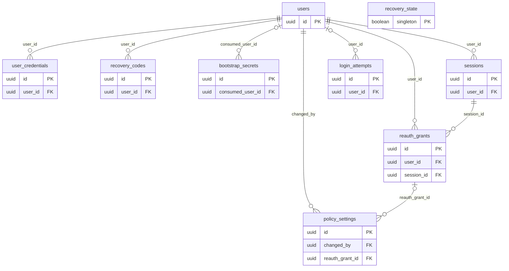
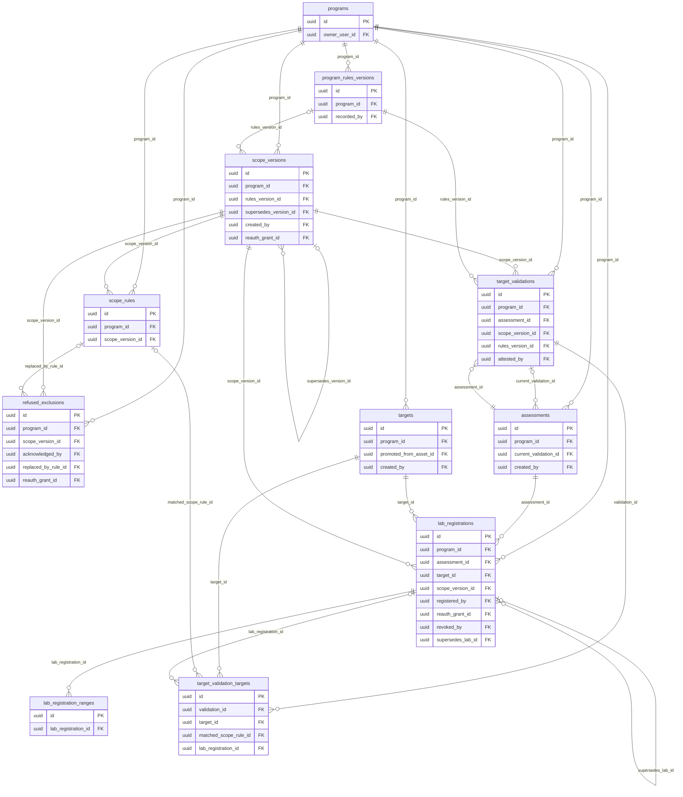
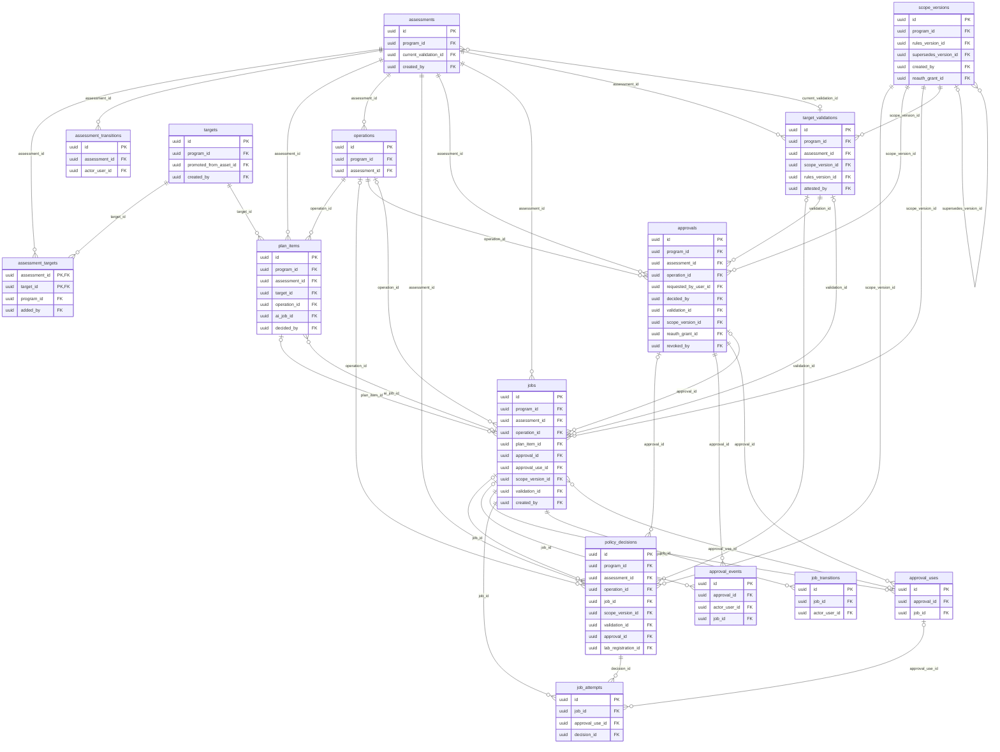
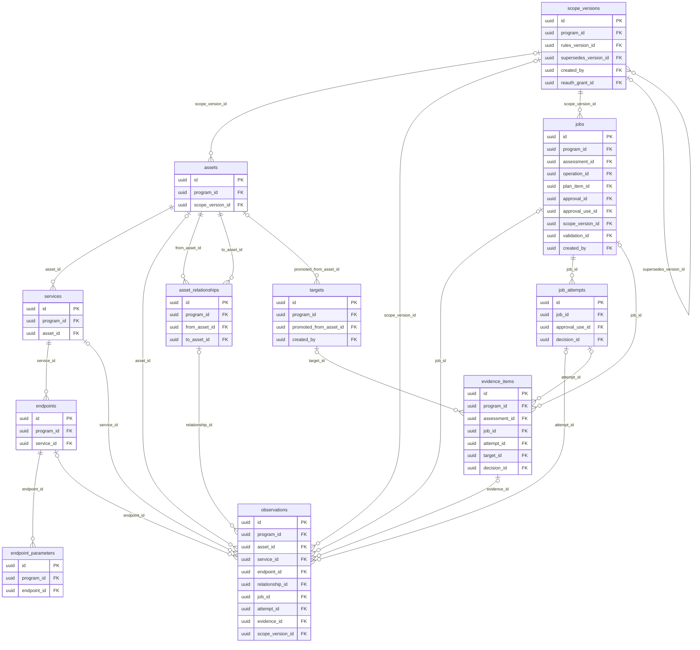
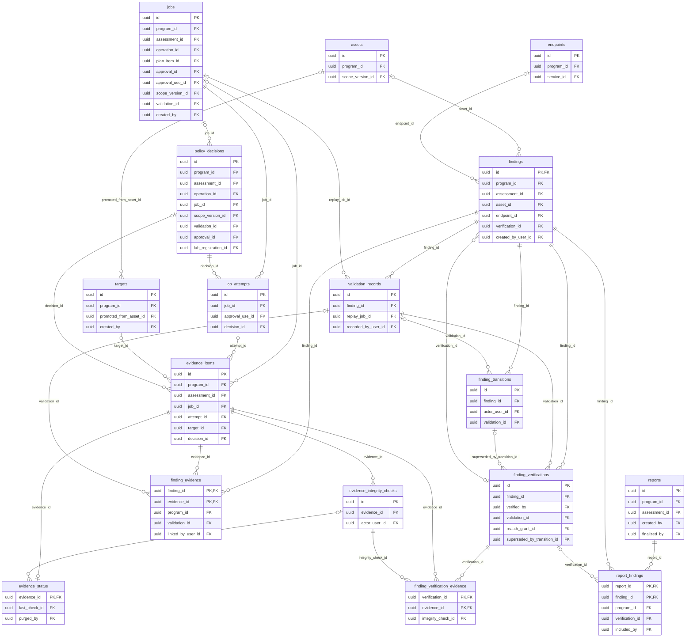
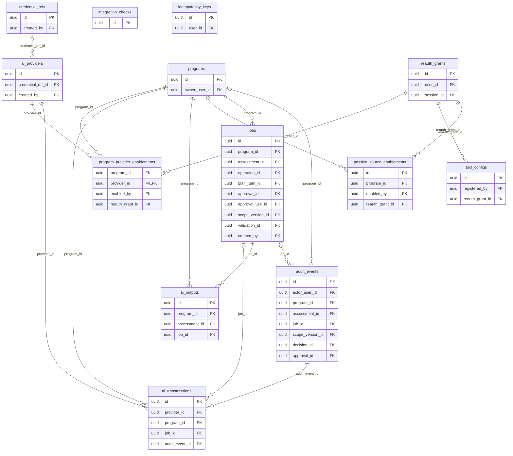
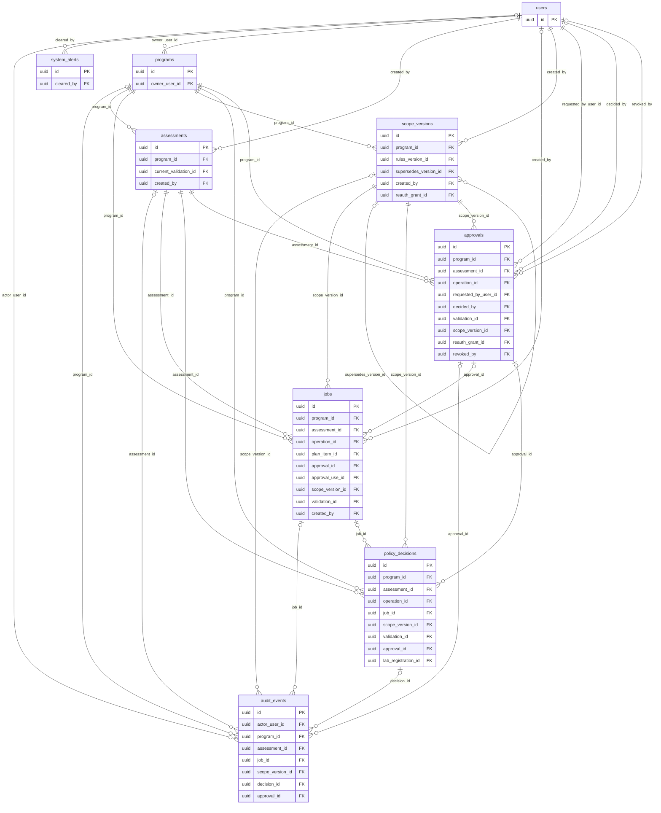

# Detailed logical ERD

Status: design proposal. Each diagram shows primary keys and foreign keys only, because the data dictionary has every column. Entities that appear in a diagram only as the target of a reference are repeated from their home domain. A dashed line is not used: Mermaid draws every relationship the same way, so optional relationships are shown with `|o` on the parent side (the child may have no parent) and mandatory ones with `||`. `o{` means zero or many children. `o|` means zero or one child (a one-to-one link).

Ownership versus operational relationships. **Ownership** is the program: every table that has `program_id` belongs to exactly one program through a composite foreign key (DB-09). **Operational** relationships record what happened to something: an attempt belongs to a job, a job consumed an approval use, an observation came from an attempt. The separate diagrams below group both kinds by domain. The cross-domain paths that matter are in `erd-high-level.md`.

## Identity and policy

## Programs, scope and target authorization

## Assessment, authorization and execution

## Asset intelligence

## Evidence, findings and reports

## AI and integrations

## Audit and cross-cutting references

## Relationships that are not drawn

- `audit_events.entity_type` and `entity_id` are a soft reference with no foreign key (DB-16). The typed columns `program_id`, `assessment_id`, `job_id`, `scope_version_id`, `decision_id` and `approval_id` are real foreign keys.
- `reauth_grants` are referenced by the tables whose action consumed a grant (`policy_settings`, `scope_versions`, `refused_exclusions`, `lab_registrations`, `approvals`, `finding_verifications`, `program_provider_enablements`, `passive_source_enablements`, `tool_configs`). They are drawn in the identity and the owning domain diagrams where both ends appear.
- Views: `finding_report_status` derives each finding's report status from `report_findings` and `reports.state`. It is not a table (DB-18).
